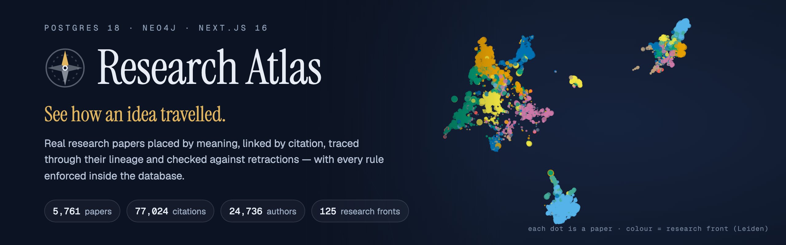
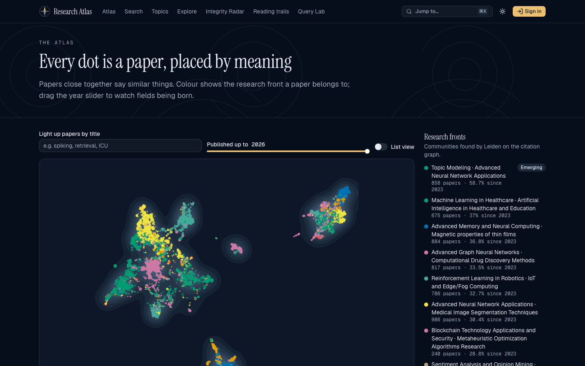
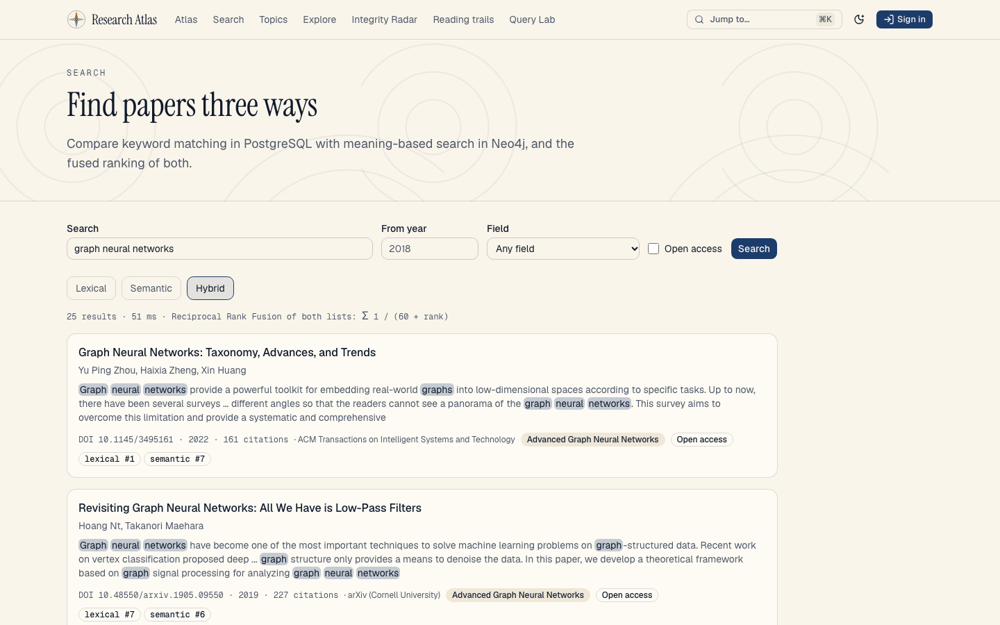
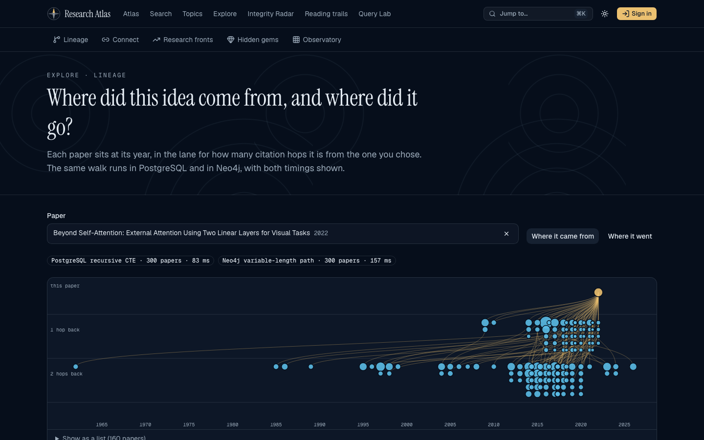
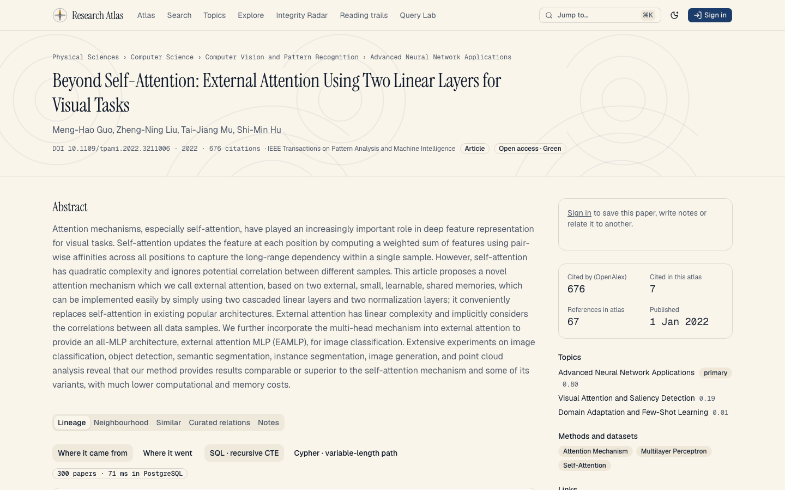
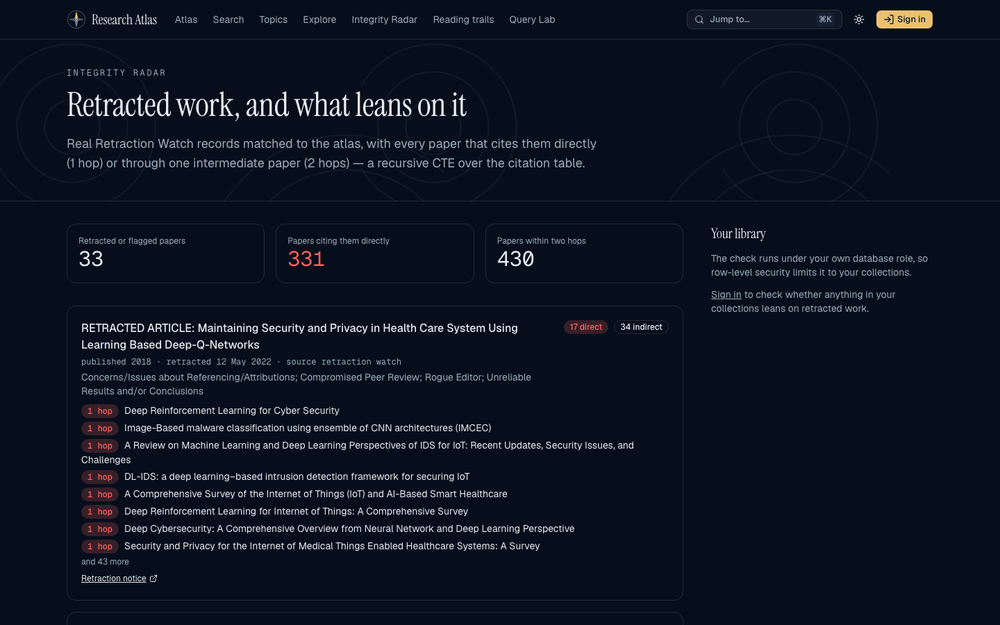
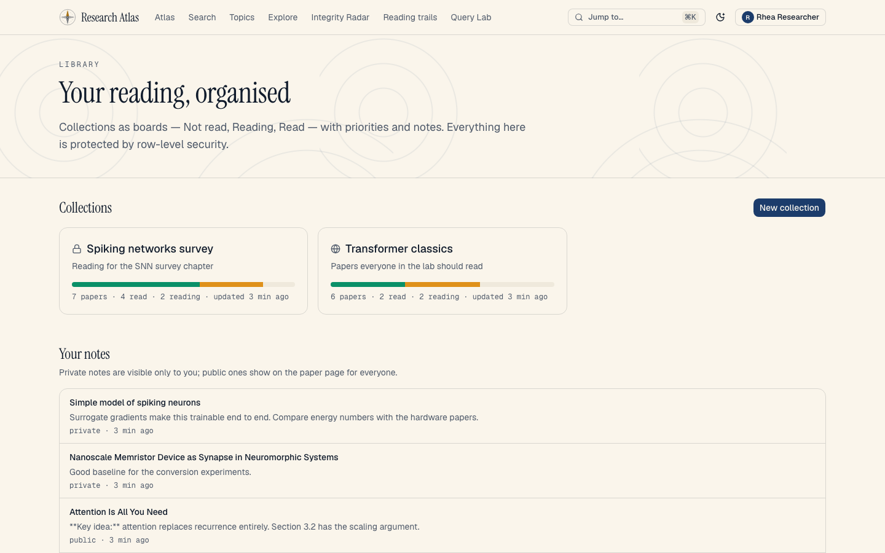
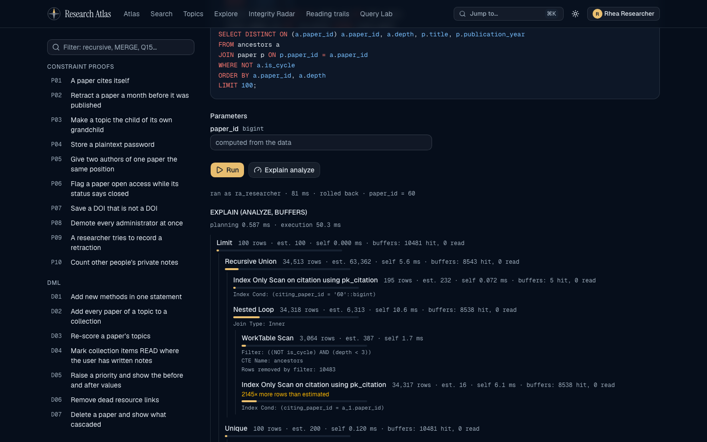
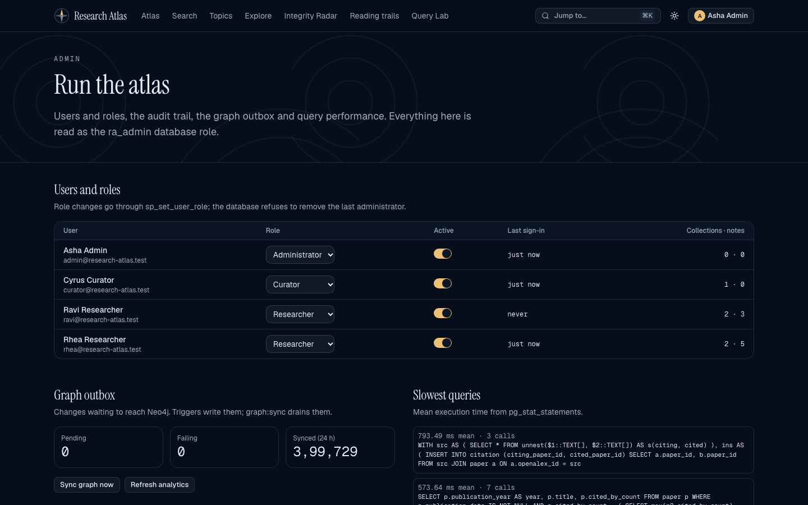
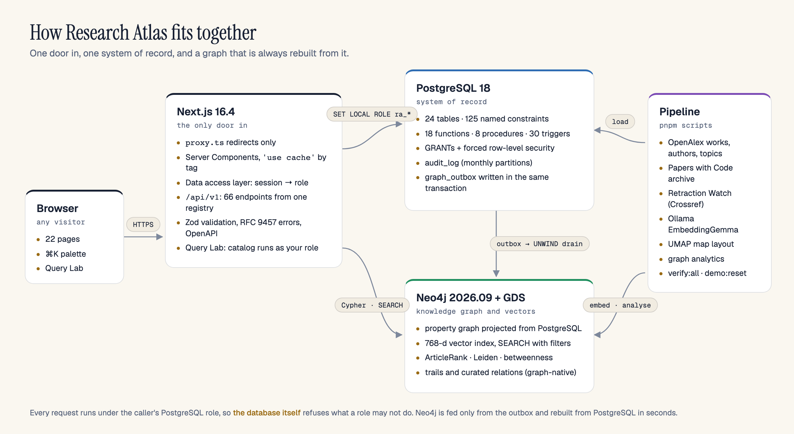

<div align="center">



<p>
  <a href="https://github.com/DBS13062006/research-atlas/actions/workflows/ci.yml"></a>
  
  
  
  
  
  
  <a href="LICENSE"></a>
</p>

**A map of research papers by meaning, citation and lineage — with every rule enforced inside the database.**

[Highlights](#highlights) · [Tour](#a-quick-tour) · [Architecture](#architecture) · [How it works](#how-it-works) ·
[Quickstart](#quickstart) · [Documentation](#documentation) · [Report (PDF)](docs/report/report.pdf)

</div>

---

Search engines tell you which papers mention a phrase. Research Atlas answers the questions that matter when
you are learning a field: **where did this idea come from, what did it lead to, how are two papers connected,
which work is quietly influential, and does anything I rely on lean on retracted research?**

It runs on a real corpus — **5,761 papers**, **77,024 citations**, **24,736 authors**, the full OpenAlex topic
hierarchy, methods and datasets from the Papers with Code archive, and **33 Retraction Watch records** — across six
themes: spiking neural networks, transformers, graph learning, computer vision, clinical machine learning and
reinforcement learning.

> DBMS mini-project · PES University · Aug–Dec 2026 · by Daruru Bhuvan Sai and Deeptanshu Kumar.

## Highlights

<table>
<tr>
<td width="33%" valign="top">

**The database is the rulebook**<br>
125 named constraints, 18 functions, 8 procedures and 30 triggers. Every request runs under the caller's own
PostgreSQL role, with GRANTs and forced row-level security deciding what they may see and do.

</td>
<td width="33%" valign="top">

**A knowledge graph that cannot drift**<br>
Neo4j holds the catalog as a graph with a 768-dimension vector index, ArticleRank, Leiden and betweenness.
It is fed only by a transactional outbox and rebuilt from PostgreSQL in seconds.

</td>
<td width="33%" valign="top">

**SQL you can watch run**<br>
The Query Lab runs every catalog query, DML statement, constraint proof, routine and trigger demo live, as your
own role — with the plan as a tree and the audit and outbox rows the triggers wrote.

</td>
</tr>
<tr>
<td valign="top">

**Search three ways**<br>
PostgreSQL full-text search, Neo4j vector search over local EmbeddingGemma embeddings, and both fused with
Reciprocal Rank Fusion — each hit shows its rank in both lists.

</td>
<td valign="top">

**Lineage, paths and fronts**<br>
Trace an idea back and forward by citation hop, find the shortest chain between two papers, and see research
fronts grow — each answered in SQL _and_ Cypher, with both timings shown.

</td>
<td valign="top">

**Built to be checked**<br>
361 pgTAP, 327 Vitest and 67 Playwright tests, axe-core on every page in both themes, Lighthouse 92–100, and a
single `pnpm verify:all` that runs everything.

</td>
</tr>
</table>

## A quick tour

<table>
<tr>
<td width="50%"><br><sub><b>Atlas</b> — every paper placed by meaning (UMAP of its embedding), coloured by research front.</sub></td>
<td width="50%"><br><sub><b>Search</b> — lexical, semantic and hybrid ranking side by side.</sub></td>
</tr>
<tr>
<td><br><sub><b>Lineage</b> — what a paper builds on, by year and hop; a recursive CTE and a Cypher path, both timed.</sub></td>
<td><br><sub><b>Paper</b> — topics, methods, datasets, citation neighbourhood, similar papers, curated relations and notes.</sub></td>
</tr>
<tr>
<td><br><sub><b>Integrity Radar</b> — retracted work and everything within two citation hops, plus a check of your own library.</sub></td>
<td><br><sub><b>Library</b> — collections as boards, private by row-level security.</sub></td>
</tr>
<tr>
<td><br><sub><b>Query Lab</b> — <code>EXPLAIN (ANALYZE, BUFFERS)</code> drawn as a plan tree.</sub></td>
<td><br><sub><b>Admin</b> — roles, the audit trail, outbox health and the slowest queries.</sub></td>
</tr>
</table>

Also: research fronts, hidden gems, the method × dataset observatory, the shortest citation chain, reading trails,
curated relations, curation by DOI import, a ⌘K palette across papers, authors and topics, and a dark _Midnight_
and light _Parchment_ theme.

## Architecture

<picture>
  <source media="(prefers-color-scheme: dark)" srcset="docs/assets/architecture-dark.png">
  
</picture>

| Layer             | Technology                                                      | Role                                                                                            |
| ----------------- | --------------------------------------------------------------- | ----------------------------------------------------------------------------------------------- |
| System of record  | **PostgreSQL 18**, pgTAP, dbmate                                | schema, constraints, functions, procedures, triggers, RBAC and RLS, audit, outbox               |
| Graph and vectors | **Neo4j 2026.09** Community, APOC, Graph Data Science           | traversal, `SEARCH` over a vector index, ArticleRank, Leiden, graph-native trails and relations |
| Application       | **Next.js 16.4**, React 19.3, TypeScript strict                 | pages, `/api/v1` (66 endpoints, OpenAPI 3.1), Query Lab                                         |
| Embeddings        | Ollama **EmbeddingGemma** (768-d), Transformers.js fallback     | local, free, cached                                                                             |
| Interface         | Tailwind CSS 4, shadcn/ui on Base UI, d3, Recharts              | accessible, responsive, two themes                                                              |
| Quality           | Vitest, Playwright, axe-core, Lighthouse, Biome, GitHub Actions | `pnpm verify:all`                                                                               |

Why two databases, why no ORM, why custom sessions and more: [technology decisions](docs/13-tech-justification.md).

## How it works

<details open>
<summary><b>Every request runs as the caller's PostgreSQL role</b></summary>

The server connects as `ra_app`, which holds no data privileges. Each unit of work switches role for one
transaction, so GRANTs and row-level security make the final decision — not the application.

```sql
BEGIN;
SELECT set_config('role', 'ra_researcher', true), set_config('app.user_id', '3', true);
-- every query here sees only what ra_researcher, acting as user 3, may see
COMMIT;
```

```sql
CREATE POLICY note_owner_all ON note FOR ALL TO ra_researcher
  USING (user_id = app_current_user_id()) WITH CHECK (user_id = app_current_user_id());
```

[Authentication and access control →](docs/10-auth-rbac.md)
</details>

<details>
<summary><b>Lineage is a recursive CTE that cannot loop</b></summary>

```sql
WITH RECURSIVE walk(paper_id, depth, path) AS (
  SELECT c.cited_paper_id, 1, ARRAY[p_paper_id] FROM citation c WHERE c.citing_paper_id = p_paper_id
  UNION ALL
  SELECT c.cited_paper_id, w.depth + 1, w.path || w.paper_id
  FROM walk w JOIN citation c ON c.citing_paper_id = w.paper_id
  WHERE w.depth < least(p_max_depth, 6)
) SEARCH BREADTH FIRST BY paper_id SET bfs_order
  CYCLE paper_id SET is_cycle USING visit_path
SELECT DISTINCT ON (walk.paper_id) walk.paper_id, walk.depth, walk.path || walk.paper_id
FROM walk WHERE NOT walk.is_cycle AND walk.paper_id <> p_paper_id
ORDER BY walk.paper_id, walk.depth, walk.bfs_order;
```

[Procedures, functions, triggers and CTEs →](docs/08-advanced-sql.md)
</details>

<details>
<summary><b>The graph is fed by a transactional outbox, never by dual writes</b></summary>

A trigger on every projected table writes a `graph_outbox` row in the same transaction as the change. A drain
replays pending rows in commit order as `UNWIND` batches of idempotent Cypher; derived co-authorship is refreshed
for exactly the authors involved. `pnpm graph:check` compares 17 counts between the stores and fails on any drift.

[NoSQL and vector database →](docs/09-nosql.md)
</details>

<details>
<summary><b>Similar papers come from a filtered vector search</b></summary>

```cypher
CYPHER 25
MATCH (seed:Paper {paperId: $paper_id})
MATCH (p:Paper)
  SEARCH p IN (VECTOR INDEX paper_embedding FOR seed.embedding WHERE p.year >= 2020 LIMIT 11) SCORE AS score
WITH seed, p, score WHERE p <> seed
RETURN p.title AS title, p.year AS year, round(score, 3) AS score
ORDER BY score DESC LIMIT 10
```
</details>

<details>
<summary><b>The database explains its own refusals</b></summary>

Every constraint and trigger is named, and the API maps SQLSTATEs to RFC 9457 problems in plain words:

```json
{
  "title": "Already exists",
  "status": 409,
  "detail": "Another paper already has this DOI.",
  "constraint": "uq_paper_doi",
  "sqlstate": "23505"
}
```

Ten constraint proofs (a self-citation, a retraction dated before publication, a topic made its own
grandparent, a plaintext password …) run live in the Query Lab and as pgTAP tests.
</details>

## Quickstart

Uses the committed 200-paper fixture, so no API key or download is needed.

| Requirement | Version                                                                                    |
| ----------- | ------------------------------------------------------------------------------------------ |
| Node.js     | 24 LTS (`.nvmrc`) and pnpm 12                                                              |
| Docker      | OrbStack or Docker Desktop with Compose                                                    |
| Ollama      | `ollama pull embeddinggemma` — or set `EMBEDDINGS_PROVIDER=transformers` to run on the CPU |

```bash
git clone https://github.com/DBS13062006/research-atlas.git && cd research-atlas
cp .env.example .env.local      # choose passwords for the containers and the demo accounts
pnpm install
pnpm setup:fixture              # containers → migrations → fixture → graph → embeddings → analytics → demo accounts
pnpm build && pnpm start        # http://localhost:3000
```

Sign in as `rhea@research-atlas.test` (researcher), `curator@research-atlas.test` or `admin@research-atlas.test`
with the `SEED_PASSWORD` you chose. On a laptop `setup:fixture` takes about half a minute.

<details>
<summary><b>Load the full 5,761-paper corpus</b></summary>

Add an OpenAlex API key to `.env.local`, then:

```bash
pnpm data:all
```

It fetches the themed corpus from OpenAlex (responses cached in `data/raw/`), loads it through `sp_import_paper`,
links methods and datasets from the Papers with Code archive, matches Retraction Watch, embeds, lays out the map,
runs the graph algorithms and seeds the demo. The run is gated: it fails if the corpus is too small or too sparse.
</details>

<details>
<summary><b>All commands</b></summary>

| Command                                                                                             | What it does                                                                           |
| --------------------------------------------------------------------------------------------------- | -------------------------------------------------------------------------------------- |
| `pnpm dev` · `build` · `start`                                                                      | Next.js development server, production build, production server                        |
| `pnpm verify:all`                                                                                   | Every check below, plus a production build served on its own port                      |
| `pnpm lint` · `typecheck` · `test` · `test:e2e`                                                     | Biome · TypeScript · Vitest · Playwright with axe-core                                 |
| `pnpm db:up` · `db:migrate` · `db:reset` · `db:rollback-all`                                        | containers · migrations · rebuild from zero · roll back to zero                        |
| `pnpm db:test`                                                                                      | rebuild the test database and run every pgTAP suite                                    |
| `pnpm queries:run` · `cypher:run`                                                                   | run the SQL and Cypher catalogs as their roles, rolled back                            |
| `pnpm graph:schema` · `graph:sync` · `graph:rebuild` · `graph:check`                                | Neo4j schema, outbox drain, full rebuild, drift check                                  |
| `pnpm graph:analytics` · `embed:papers` · `layout:umap`                                             | ArticleRank, Leiden, similarity · embeddings · map layout                              |
| `pnpm data:all` · `setup:fixture` · `seed:demo` · `demo:reset`                                      | full pipeline · fixture install · demo accounts · restore demo state                   |
| `pnpm docs:catalog` · `docs:report` · `docs:schema` · `docs:er` · `docs:brand` · `docs:screenshots` | regenerate chapters 5–7, the PDF report, schema docs, ER diagram, artwork, screenshots |
| `pnpm perf:lighthouse`                                                                              | Lighthouse gate on the home and a paper page                                           |

</details>

## Project structure

```text
research-atlas/
├── db/
│   ├── migrations/      16 dbmate migrations, each with up and down
│   ├── queries/         Q01–Q25 · dml/ D01–D10 · proofs/ P01–P10 · routines/ R01–R06 · triggers/ T01–T04
│   ├── tests/           pgTAP suites: constraints, functions, procedures, triggers, views, RBAC
│   └── seed/            committed 200-paper fixture and the pgTAP seed
├── graph/               Neo4j schema and the Cypher catalog C01–C12
├── src/
│   ├── app/             pages and the /api/v1 route handlers
│   ├── components/      shell, common states, atlas, graphs, charts, lab, library, paper, ui
│   ├── lib/             shared types, Zod schemas, API client, query-catalog parser
│   └── server/          auth, db, graph, api registry, services, embeddings (server-only)
├── scripts/             ingest · embed · layout · graph · db · docs · setup · verify
├── tests/               unit · integration (Vitest) · e2e (Playwright + axe-core)
└── docs/                15 chapters, ER and schema diagrams, screenshots, report
```

Each top-level folder has its own guide: [`db/`](db/README.md), [`graph/`](graph/README.md),
[`scripts/`](scripts/README.md), [`src/`](src/README.md), [`tests/`](tests/README.md).

## Quality

| Check                                                                  | Result                                                                |
| ---------------------------------------------------------------------- | --------------------------------------------------------------------- |
| pgTAP — constraints, functions, procedures, triggers, views, RBAC      | **361** passing                                                       |
| Vitest — units, API role matrix (264 cases), graph services, Query Lab | **327** passing                                                       |
| Playwright — every page, role access, Query Lab, palette               | **67** passing                                                        |
| SQL and Cypher catalogs on the real corpus                             | **55 + 12** files, all returning rows                                 |
| Migrations                                                             | rolled back to zero and up again on every verify                      |
| Accessibility — axe-core, WCAG 2.2 AA, both themes                     | **0** serious or critical findings on 22 pages                        |
| Lighthouse — home and paper page                                       | performance **92–100**, accessibility **100**, best practices **100** |
| Graph consistency                                                      | **0** drift across 17 counts                                          |

## Documentation

|     | Chapter                                             |                                                                |
| --- | --------------------------------------------------- | -------------------------------------------------------------- |
| 1   | [Requirements](docs/01-requirements.md)             | problem, roles, 12 use cases                                   |
| 2   | [ER model](docs/02-er-model.md)                     | Chen diagram, 15 entities, 17 relationships                    |
| 3   | [Relational schema](docs/03-relational-schema.md)   | mapping, keys, delete rules, indexes                           |
| 4   | [Normalization](docs/04-normalization.md)           | FDs and BCNF per table, two deliberate denormalizations        |
| 5   | [DDL and constraints](docs/05-ddl.md)               | every named constraint, index, trigger and proof _(generated)_ |
| 6   | [DML](docs/06-dml.md)                               | D01–D10 with real outputs _(generated)_                        |
| 7   | [Queries](docs/07-queries.md)                       | Q01–Q25 with outputs and plans _(generated)_                   |
| 8   | [Advanced SQL](docs/08-advanced-sql.md)             | functions, procedures, triggers, views, CTEs                   |
| 9   | [NoSQL and vectors](docs/09-nosql.md)               | graph model, outbox, vector search, GDS, read/update/delete    |
| 10  | [Auth and RBAC](docs/10-auth-rbac.md)               | sessions, role ladder, privilege matrix, RLS, psql proof       |
| 11  | [API](docs/11-api.md)                               | conventions, error mapping, all 66 endpoints                   |
| 12  | [Architecture](docs/12-architecture.md)             | components, rendering and caching, consistency model           |
| 13  | [Technology choices](docs/13-tech-justification.md) | nine decision records                                          |
| 14  | [Testing](docs/14-testing.md)                       | strategy and the latest `verify:all`                           |
| 15  | [User guide](docs/15-user-guide.md)                 | tour, demo accounts, troubleshooting                           |

The full **[project report (PDF)](docs/report/report.pdf)** follows the evaluation rubric.

<details>
<summary><b>Rubric map</b></summary>

| #   | Rubric row                                       | Where                                                                                                                           |
| --- | ------------------------------------------------ | ------------------------------------------------------------------------------------------------------------------------------- |
| 1   | ER diagram                                       | [ER diagram](docs/er/research-atlas-er.svg), [chapter 2](docs/02-er-model.md)                                                   |
| 2   | Relational schema, keys, constraints             | [chapter 3](docs/03-relational-schema.md), [generated schema](docs/schema/README.md), [normalization](docs/04-normalization.md) |
| 3   | DDL with constraints                             | [`db/migrations/`](db/migrations), [chapter 5](docs/05-ddl.md), [pgTAP](db/tests)                                               |
| 4   | NoSQL / vector database creation                 | [`graph/schema.cypher`](graph/schema.cypher), [projection](src/server/graph/projection.ts), [chapter 9](docs/09-nosql.md)       |
| 5   | Technology justification                         | [chapter 13](docs/13-tech-justification.md)                                                                                     |
| 6   | DML                                              | [`db/queries/dml/`](db/queries/dml), [chapter 6](docs/06-dml.md)                                                                |
| 7   | Nested, correlated, recursive and join queries   | [`db/queries/`](db/queries), [chapter 7](docs/07-queries.md)                                                                    |
| 8   | Procedures, functions, triggers, CTEs            | [migrations 200–230](db/migrations), [chapter 8](docs/08-advanced-sql.md)                                                       |
| 9   | NoSQL / vector feature with read, update, delete | [relations](src/server/graph/relations.ts), [trails](src/server/graph/trails.ts), [chapter 9](docs/09-nosql.md)                 |
| 10  | Next.js interface                                | [`src/app/`](src/app), [user guide](docs/15-user-guide.md)                                                                      |
| 11  | Backend / API and database integration           | [`/api/v1`](src/app/api/v1), [registry](src/server/api/registry.ts), [chapter 11](docs/11-api.md)                               |
| 12  | Authentication, roles, RBAC in the database      | [`300_rbac.sql`](db/migrations/300_rbac.sql), [`src/server/auth/`](src/server/auth), [chapter 10](docs/10-auth-rbac.md)         |
| 13  | Documentation and Git                            | this README, [`docs/`](docs), [CI](.github/workflows/ci.yml), [CONTRIBUTING](CONTRIBUTING.md)                                   |
| 14  | Originality and contribution                     | Query Lab, dual-database comparisons, Integrity Radar; [contributions](docs/report/report.pdf)                                  |

</details>

## Acknowledgements

- [OpenAlex](https://openalex.org) — works, authors, institutions, venues and topics (CC0).
- [Retraction Watch database](https://gitlab.com/crossref/retraction-watch-data), made openly available by Crossref.
- The final [Papers with Code](https://paperswithcode.com) archive — methods and datasets (CC BY-SA 4.0).
- [EmbeddingGemma](https://ai.google.dev/gemma) run locally through [Ollama](https://ollama.com).

## Licence

Code is released under the [MIT licence](LICENSE). Data keeps the licence of its source. To cite this project, see
[`CITATION.cff`](CITATION.cff).
