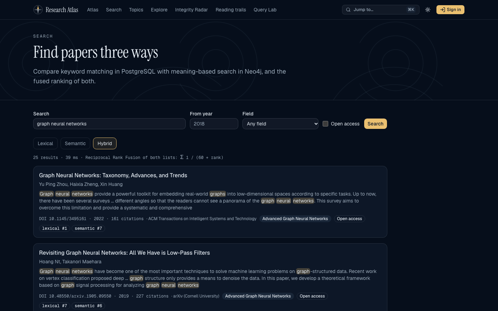
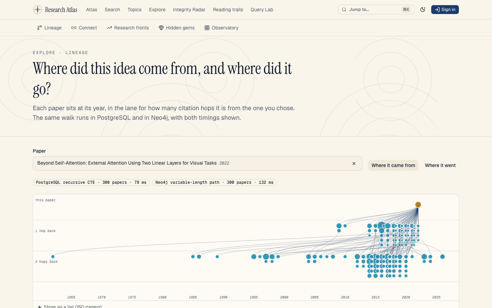
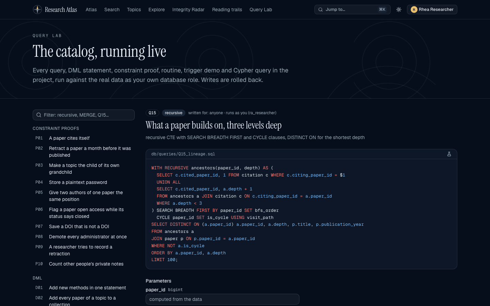
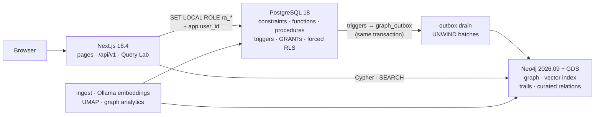

# Research Atlas

[](https://github.com/DBS13062006/research-atlas/actions/workflows/ci.yml)

**See how an idea travelled.** Research Atlas maps 5,761 real research papers by meaning, links them by
77,024 citations, traces where each idea came from and where it went, and checks every paper against
retractions — with its rules enforced inside the database, not just in the app.

DBMS mini-project, PES University (Aug–Dec 2026) — Daruru Bhuvan Sai (PES1UG24AM356) and
Deeptanshu Kumar (PES1UG24AM357).


## What it does

PostgreSQL 18 is the system of record, with role-based access and row-level security enforced by the
database itself. Neo4j 2026.09 holds the same catalog as a knowledge graph with a 768-dimension vector
index, graph algorithms, and two graph-native features with full read, update and delete. A Next.js 16.4
app is the only way in.

|                                                                                                                                                                                                                    |                                                                                                                                                                                                                     |
| ------------------------------------------------------------------------------------------------------------------------------------------------------------------------------------------------------------------ | ------------------------------------------------------------------------------------------------------------------------------------------------------------------------------------------------------------------- |
|  **Search three ways.** PostgreSQL full-text search, Neo4j vector search, and both fused with Reciprocal Rank Fusion; every hit shows its rank in each list. |  **Trace an idea.** What a paper builds on and what it started, by year and citation hop, computed by a recursive CTE and by a Cypher path query, with both timings.  |
|  **Every paper in context.** Topics, methods, datasets, citation neighbourhood, similar papers, curated relations and notes.                                        |  **Check the ground.** Retracted papers and everything within two citation hops, and a check of your own library.                                            |
|  **Organise reading.** Collections as Kanban boards with priorities and Markdown notes, private by row-level security.                                               |  **Query Lab.** Run every catalog query, DML statement, constraint proof, routine, trigger demo and Cypher query as your own database role, with plans and side effects. |

Also: research fronts (Leiden communities), hidden gems (ArticleRank against citation count), the
method × dataset observatory, the shortest citation chain between two papers, reading trails, curated
relations (extends, improves upon, contradicts, replicates), curation by DOI import, an admin console, a
⌘K command palette, and a versioned REST API with [OpenAPI docs](http://localhost:3000/api/docs).

## Architecture



Every request runs under the caller's PostgreSQL role, so the database refuses what a role may not do.
Neo4j is fed only from PostgreSQL's transactional outbox and can be rebuilt from it in seconds. Details in
[chapter 12](docs/12-architecture.md).

## Quickstart (committed 200-paper fixture)

Needs Node 24, pnpm, Docker (OrbStack or Docker Desktop) and [Ollama](https://ollama.com) with
`ollama pull embeddinggemma` (or set `EMBEDDINGS_PROVIDER=transformers` to run the same model on the CPU).

```bash
cp .env.example .env.local      # choose passwords for the containers and the demo accounts
pnpm install
pnpm setup:fixture              # containers, migrations, fixture, graph, embeddings, analytics, demo accounts
pnpm build && pnpm start        # http://localhost:3000
```

Sign in as `rhea@research-atlas.test` (researcher), `curator@research-atlas.test` or
`admin@research-atlas.test` with the `SEED_PASSWORD` you chose. `pnpm demo:reset` restores the demo state.

**Full corpus.** Add an OpenAlex API key to `.env.local` and run `pnpm data:all`: it fetches the themed
corpus, loads it through `sp_import_paper`, links methods and datasets from the Papers with Code archive,
matches Retraction Watch, embeds, lays out the map and runs the graph algorithms. Responses are cached, so
re-runs are fast.

## Rubric map

| #   | Rubric row                                       | Where                                                                                                                           |
| --- | ------------------------------------------------ | ------------------------------------------------------------------------------------------------------------------------------- |
| 1   | ER diagram                                       | [Chen ER diagram](docs/er/research-atlas-er.png), [chapter 2](docs/02-er-model.md)                                              |
| 2   | Relational schema, keys, constraints             | [chapter 3](docs/03-relational-schema.md), [generated schema](docs/schema/README.md), [normalization](docs/04-normalization.md) |
| 3   | DDL with constraints                             | [`db/migrations/`](db/migrations), [chapter 5](docs/05-ddl.md) (125 named constraints, proofs), [pgTAP](db/tests)               |
| 4   | NoSQL / vector database creation                 | [`graph/schema.cypher`](graph/schema.cypher), [projection](src/server/graph/projection.ts), [chapter 9](docs/09-nosql.md)       |
| 5   | Technology justification                         | [chapter 13](docs/13-tech-justification.md)                                                                                     |
| 6   | DML                                              | [`db/queries/dml/`](db/queries/dml), [chapter 6](docs/06-dml.md), Query Lab                                                     |
| 7   | Nested, correlated, recursive and join queries   | [`db/queries/`](db/queries), [chapter 7](docs/07-queries.md) with outputs and plans, Query Lab                                  |
| 8   | Procedures, functions, triggers, CTEs            | [`200`–`230` migrations](db/migrations), [chapter 8](docs/08-advanced-sql.md), Query Lab R and T groups                         |
| 9   | NoSQL / vector feature with read, update, delete | [relations](src/server/graph/relations.ts), [trails](src/server/graph/trails.ts), vector search, [chapter 9](docs/09-nosql.md)  |
| 10  | Next.js interface                                | [`src/app/`](src/app), [user guide](docs/15-user-guide.md), [screenshots](docs/screenshots)                                     |
| 11  | Backend / API and database integration           | [`/api/v1`](src/app/api/v1), [registry](src/server/api/registry.ts), [chapter 11](docs/11-api.md)                               |
| 12  | Authentication, roles and RBAC in the database   | [`300_rbac.sql`](db/migrations/300_rbac.sql), [`src/server/auth/`](src/server/auth), [chapter 10](docs/10-auth-rbac.md)         |
| 13  | Documentation and Git                            | this README, [`docs/`](docs), [CI](.github/workflows/ci.yml)                                                                    |
| 14  | Originality and contribution                     | the signature features above; commit history                                                                                    |

## Documentation

1. [Requirements](docs/01-requirements.md) ·
2. [ER model](docs/02-er-model.md) ·
3. [Relational schema](docs/03-relational-schema.md) ·
4. [Normalization](docs/04-normalization.md) ·
5. [DDL](docs/05-ddl.md) ·
6. [DML](docs/06-dml.md) ·
7. [Queries](docs/07-queries.md) ·
8. [Advanced SQL](docs/08-advanced-sql.md) ·
9. [NoSQL and vectors](docs/09-nosql.md) ·
10. [Auth and RBAC](docs/10-auth-rbac.md) ·
11. [API](docs/11-api.md) ·
12. [Architecture](docs/12-architecture.md) ·
13. [Technology choices](docs/13-tech-justification.md) ·
14. [Testing](docs/14-testing.md) ·
15. [User guide](docs/15-user-guide.md) ·
    [Report](docs/report/report.pdf)

## Stack

PostgreSQL 18 · pgTAP · dbmate · Neo4j 2026.09 Community with APOC and Graph Data Science · Ollama
EmbeddingGemma · Next.js 16.4 · React 19.3 · TypeScript (strict) · postgres.js · Zod 4 · Tailwind CSS 4 ·
shadcn/ui on Base UI · d3 · Recharts · Vitest · Playwright · axe-core · Lighthouse · Biome · GitHub Actions.

## Testing

```bash
pnpm verify:all
```

One command runs lint and types, a migration round trip, 361 pgTAP tests, all 55 SQL and 12 Cypher
catalog files, a graph rebuild with a drift check, 327 Vitest tests, a production build, 67 Playwright
tests (including axe-core on every page in both themes) and Lighthouse. See [chapter 14](docs/14-testing.md).

## Data and credits

- [OpenAlex](https://openalex.org) — works, authors, institutions, venues and topics (CC0).
- [Retraction Watch database](https://gitlab.com/crossref/retraction-watch-data), made openly available by
  Crossref.
- The final [Papers with Code](https://paperswithcode.com) archive — methods and datasets (CC BY-SA 4.0).

Code is released under the MIT licence.
