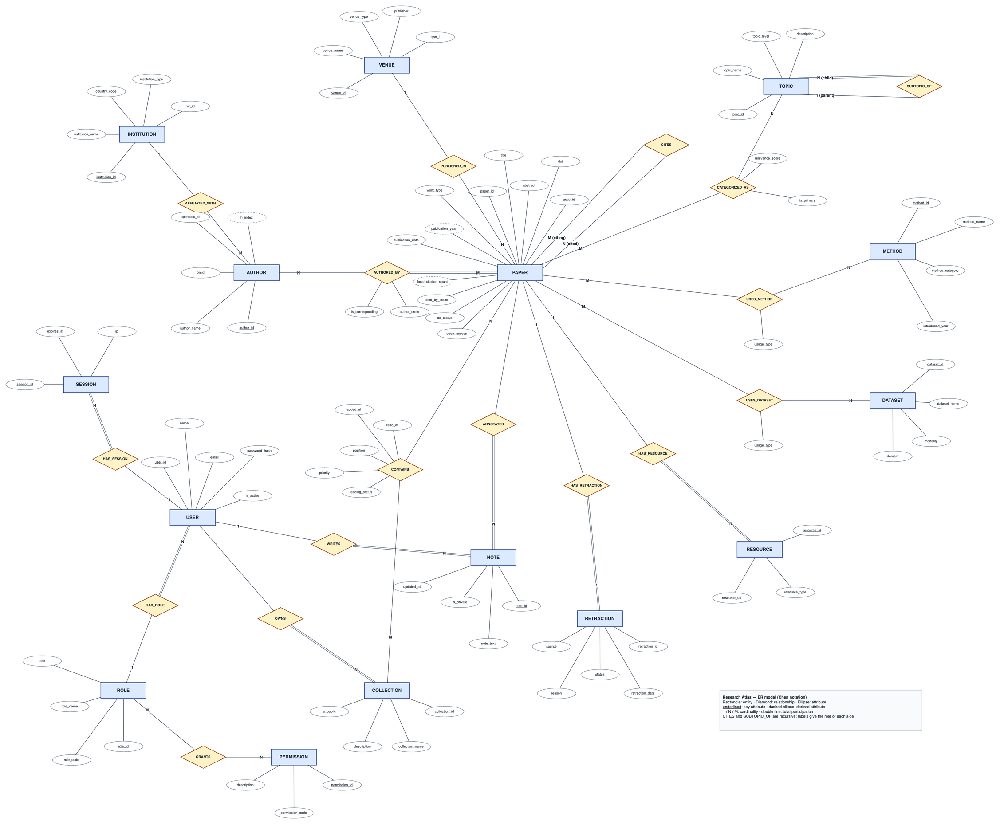

# 2. Entity–relationship model

The conceptual model has **15 entities and 17 relationships**, drawn in Chen notation. The diagram is
generated from [`scripts/er/generate-drawio.ts`](../scripts/er/generate-drawio.ts) into
[`docs/er/research-atlas-er.drawio`](er/research-atlas-er.drawio) and exported to PNG and SVG with the draw.io
command line (`pnpm docs:er`).

**Notation.** Rectangles are entities; diamonds are relationships; ellipses are attributes, with the key
underlined and derived attributes dashed. Each relationship line carries its cardinality (1, N, M). A
double line means total participation: every instance of that entity must take part.

## 2.1 Entities

| Entity      | Key                               | Main attributes                                                                                                                                       | Notes                                                     |
| ----------- | --------------------------------- | ----------------------------------------------------------------------------------------------------------------------------------------------------- | --------------------------------------------------------- |
| INSTITUTION | institution_id                    | name, country code, type, ROR id, website                                                                                                             | Where authors work                                        |
| AUTHOR      | author_id                         | name, ORCID, OpenAlex id, profile URL, *h_index* (derived)                                                                                            | ORCID is optional but unique                              |
| VENUE       | venue_id                          | name, type, ISSN-L, publisher                                                                                                                         | Journal, conference or repository                         |
| PAPER       | paper_id                          | title, abstract, DOI, arXiv id, OpenAlex id, publication date, *publication_year* and *local_citation_count* (derived), work type, open-access status | The centre of the model                                   |
| TOPIC       | topic_id                          | name, level (0–3), description                                                                                                                        | OpenAlex domain → field → subfield → topic                |
| METHOD      | method_id                         | name, category, description, year introduced                                                                                                          | From the Papers with Code archive and an alias dictionary |
| DATASET     | dataset_id                        | name, modality, domain, URL, description                                                                                                              | Same source                                               |
| RESOURCE    | resource_id                       | URL, type (code, slides, video …)                                                                                                                     | Weak in spirit: it only exists for a paper                |
| RETRACTION  | retraction_id                     | date, status, reason, notice URL, source                                                                                                              | At most one per paper                                     |
| USER        | user_id                           | name, email, password hash, active, lockout fields                                                                                                    | Application account                                       |
| ROLE        | role_id                           | code, name, rank, database role name                                                                                                                  | Researcher, curator, administrator                        |
| PERMISSION  | permission_id                     | code, description                                                                                                                                     | e.g. `papers:write`, `lab:dml`                            |
| SESSION     | session_id (SHA-256 of the token) | created, last seen, expiry, IP, user agent                                                                                                            | The token itself is never stored                          |
| COLLECTION  | collection_id                     | name, description, public flag                                                                                                                        | A user's reading list                                     |
| NOTE        | note_id                           | text (Markdown), private flag                                                                                                                         | A user's note on a paper                                  |

## 2.2 Relationships

| Relationship            | Entities             | Cardinality | Participation           | Attributes                                            | Why                                                    |
| ----------------------- | -------------------- | ----------- | ----------------------- | ----------------------------------------------------- | ------------------------------------------------------ |
| AFFILIATED_WITH         | AUTHOR – INSTITUTION | N : 1       | partial both            | —                                                     | An author's current institution may be unknown         |
| PUBLISHED_IN            | PAPER – VENUE        | N : 1       | partial both            | —                                                     | Preprints may have no venue                            |
| AUTHORED_BY             | PAPER – AUTHOR       | M : N       | total on PAPER          | author_order, is_corresponding                        | Every paper has at least one author; position matters  |
| CITES (recursive)       | PAPER – PAPER        | M : N       | partial                 | —                                                     | Roles _citing_ and _cited_; a paper cannot cite itself |
| CATEGORIZED_AS          | PAPER – TOPIC        | M : N       | partial                 | relevance_score, is_primary                           | OpenAlex scores each topic                             |
| SUBTOPIC_OF (recursive) | TOPIC – TOPIC        | N : 1       | total on non-root child | —                                                     | Only domains (level 0) have no parent                  |
| USES_METHOD             | PAPER – METHOD       | M : N       | partial                 | usage_type                                            | Proposed, used, compared, extended, baseline           |
| USES_DATASET            | PAPER – DATASET      | M : N       | partial                 | usage_type                                            | Training, validation, testing, benchmarking            |
| HAS_RESOURCE            | PAPER – RESOURCE     | 1 : N       | total on RESOURCE       | —                                                     | A resource without a paper is meaningless              |
| HAS_RETRACTION          | PAPER – RETRACTION   | 1 : 0..1    | total on RETRACTION     | —                                                     | One retraction record per paper at most                |
| HAS_ROLE                | USER – ROLE          | N : 1       | total on USER           | —                                                     | Every account has exactly one role                     |
| GRANTS                  | ROLE – PERMISSION    | M : N       | partial                 | —                                                     | The permission matrix                                  |
| HAS_SESSION             | USER – SESSION       | 1 : N       | total on SESSION        | —                                                     | Several devices at once                                |
| OWNS                    | USER – COLLECTION    | 1 : N       | total on COLLECTION     | —                                                     | Collections belong to someone                          |
| CONTAINS                | COLLECTION – PAPER   | M : N       | partial                 | reading_status, priority, position, added_at, read_at | The Kanban board                                       |
| WRITES                  | USER – NOTE          | 1 : N       | total on NOTE           | —                                                     |                                                        |
| ANNOTATES               | NOTE – PAPER         | N : 1       | total on NOTE           | —                                                     | A note is always about one paper                       |

## 2.3 Cardinality and participation decisions

- **AUTHORED_BY is total on PAPER** but not on AUTHOR: an author record can outlive its last paper (for
  example after a merge), while a paper without authors is a data error. The database enforces the paper
  side when papers are imported through `sp_import_paper`.
- **CITES is M:N and recursive.** The two roles become `citing_paper_id` and `cited_paper_id` in the
  relational schema, and `chk_no_self_citation` forbids the reflexive case.
- **SUBTOPIC_OF is total on non-root children.** A CHECK constraint ties the parent to the level
  (`chk_topic_only_domains_are_roots`) and a trigger refuses cycles and level inversions.
- **HAS_RETRACTION is 1 : 0..1**, which becomes a foreign key plus `UNIQUE (paper_id)` on `retraction`.
- **Derived attributes** are drawn dashed. `publication_year` is a virtual generated column;
  `local_citation_count` is kept exact by a statement-level trigger; `h_index` is computed by
  `fn_author_h_index` and cached in a materialized view. Chapter 4 explains why these two stored values do not
  break normal form.

## 2.4 What lives outside the relational model

Reading trails, curated relations (EXTENDS, IMPROVES_UPON, CONTRADICTS, REPLICATES, RELATED_TO), co-authorship,
semantic similarity, communities and influence scores live in Neo4j. They are graph-native: either created
there by users or computed there by graph algorithms. Chapter 9 describes that model.

<!-- chapter-nav -->

---

[← Requirements](01-requirements.md) · [Documentation index](README.md) · [Relational schema →](03-relational-schema.md)
