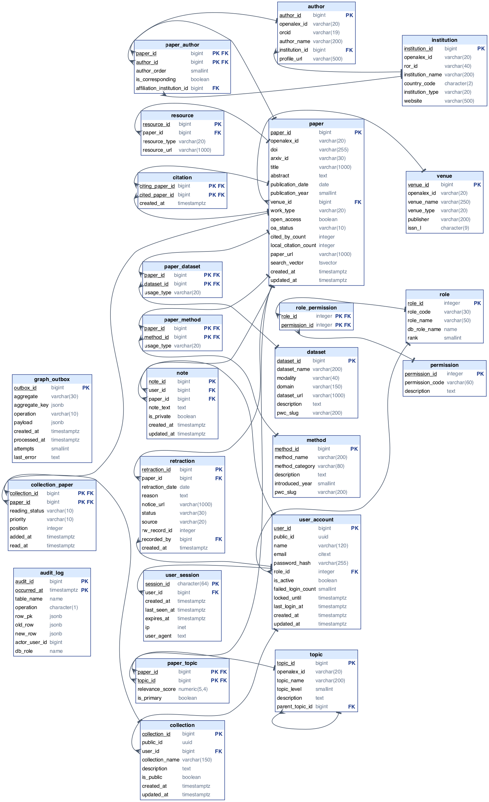

# 3. Relational schema

The ER model (chapter 2) maps to **24 tables**: 22 domain tables plus `audit_log` and `graph_outbox`.
Every table, column, key and constraint below is generated from the live database in
[`docs/schema/`](schema/README.md), so the diagram always matches the DDL in
[`db/migrations/`](../db/migrations).

## 3.1 Mapping rules used

| ER construct                                   | Relational mapping                                                                        | Example                                                                    |
| ---------------------------------------------- | ----------------------------------------------------------------------------------------- | -------------------------------------------------------------------------- |
| Strong entity                                  | Table with a surrogate `BIGINT GENERATED ALWAYS AS IDENTITY` key                          | `paper(paper_id)`                                                          |
| N:1 relationship                               | Foreign key on the N side                                                                 | `paper.venue_id → venue`                                                   |
| 1:N relationship with total participation on N | `NOT NULL` foreign key on the N side                                                      | `resource.paper_id NOT NULL`                                               |
| 1:0..1 relationship                            | Foreign key plus `UNIQUE`                                                                 | `retraction.paper_id UNIQUE`                                               |
| M:N relationship                               | Link table whose primary key is both foreign keys; relationship attributes become columns | `paper_author(paper_id, author_id, author_order, …)`                       |
| Recursive M:N (CITES)                          | Link table with two foreign keys to the same table and role-named columns                 | `citation(citing_paper_id, cited_paper_id)`                                |
| Recursive N:1 (SUBTOPIC_OF)                    | Self-referencing foreign key                                                              | `topic.parent_topic_id → topic`                                            |
| Derived attribute                              | Generated column or trigger-maintained column                                             | `paper.publication_year` (VIRTUAL), `paper.local_citation_count` (trigger) |

## 3.2 Keys

- **Surrogate keys everywhere.** `GENERATED ALWAYS AS IDENTITY` (SQL standard) instead of `SERIAL`: the
  sequence belongs to the column, and a client cannot accidentally insert its own id without
  `OVERRIDING SYSTEM VALUE`.
- **Natural keys kept as alternate keys.** `doi`, `openalex_id`, `arxiv_id`, `orcid`, `ror_id`,
  `issn_l` are each `UNIQUE` and nullable, because a paper may lack a DOI but two papers may never share one.
- **Public identifiers.** `user_account.public_id` and `collection.public_id` are `uuidv7()` values
  (PostgreSQL 18). They appear in URLs instead of sequential ids, which would leak how many users exist;
  v7 UUIDs are time-ordered, so their B-tree index stays compact.
- **Composite keys on link tables.** `paper_author(paper_id, author_id)`, `citation(citing_paper_id,
  cited_paper_id)`, `collection_paper(collection_id, paper_id)` and so on: a pair can appear only once.
- **Second candidate key.** `paper_author(paper_id, author_order)` is also unique (`uq_paper_author_order`),
  declared `DEFERRABLE INITIALLY IMMEDIATE` so two authors can swap positions in one transaction.

## 3.3 Constraint inventory

All 126 constraints are named with a prefix that says what they are (`pk_`, `fk_`, `uq_`, `chk_`), so
an error message names the rule that was broken. A selection:

| Constraint                                        | Rule it enforces                                                          |
| ------------------------------------------------- | ------------------------------------------------------------------------- |
| `chk_no_self_citation`                            | A paper cannot cite itself                                                |
| `chk_paper_oa_status_matches_flag`                | Cross-column: `CLOSED` status ⇔ `open_access = false`                     |
| `chk_paper_doi_format`, `chk_paper_doi_lowercase` | DOIs are stored bare (`10.xxxx/…`) and lower-case                         |
| `chk_user_account_password_is_argon2id`           | Only Argon2id hashes can be stored, so plaintext passwords are impossible |
| `uq_user_account_email` on `CITEXT`               | `Alice@x.org` and `alice@x.org` are the same account                      |
| `uq_topic_name_in_parent` (`NULLS NOT DISTINCT`)  | Topic names are unique within a parent, including among root domains      |
| `chk_topic_only_domains_are_roots`                | `(topic_level = 0) = (parent_topic_id IS NULL)`                           |
| `uq_one_primary_topic` (partial unique index)     | At most one `is_primary` topic per paper                                  |
| `chk_collection_paper_read_at_matches_status`     | `read_at` is set exactly when the status is `READ`                        |
| `chk_user_session_id_is_sha256_hex`               | Only the SHA-256 digest of a session token is stored, never the token     |

Rules that a `CHECK` cannot express because they read another row or table are enforced by triggers
(chapter 8): retraction date not before publication, no cycles in the topic tree, and never zero admins.

Every constraint has an accept and a reject test in [`db/tests/10_constraints.sql`](../db/tests/10_constraints.sql);
a meta-test fails the suite if a new constraint is added without them.

## 3.4 Delete rules

| Situation                                                                 | Rule                                                                                                              | Reason                                                                                                |
| ------------------------------------------------------------------------- | ----------------------------------------------------------------------------------------------------------------- | ----------------------------------------------------------------------------------------------------- |
| A paper is deleted                                                        | `CASCADE` to authorships, citations, topic/method/dataset links, resources, retraction, notes, collection entries | These facts mean nothing without the paper                                                            |
| A shared catalog row (author, topic, method, dataset) is still referenced | `RESTRICT` (SQLSTATE 23001)                                                                                       | Silently losing curated links is worse than an error; admins merge duplicates with `sp_merge_authors` |
| A venue or institution is deleted                                         | `SET NULL`                                                                                                        | The paper or author stays valid without it                                                            |
| A user is deleted                                                         | `CASCADE` to sessions, collections, notes; `SET NULL` on `retraction.recorded_by`                                 | Personal data goes; integrity records stay                                                            |
| A role still has users                                                    | `RESTRICT`                                                                                                        | Every user must keep a valid role                                                                     |

## 3.5 Indexes

PostgreSQL indexes primary keys and unique constraints automatically but **not foreign keys**, so every
foreign key that is not the leading column of a primary key has its own B-tree index (18 in
`050_indexes.sql`). Beyond those:

| Index                                        | Type                                         | Serves                                                                         |
| -------------------------------------------- | -------------------------------------------- | ------------------------------------------------------------------------------ |
| `ix_paper_search_vector`                     | GIN on the stored `tsvector`                 | Ranked full-text search                                                        |
| `ix_paper_title_trgm`, `ix_author_name_trgm` | GIN with `gin_trgm_ops`                      | Typo-tolerant lookup (`%`, `similarity()`)                                     |
| `ix_paper_publication_date`                  | B-tree                                       | Year filters as date ranges (the VIRTUAL `publication_year` cannot be indexed) |
| `ix_paper_open_access_date`                  | Partial B-tree `WHERE open_access`           | Open-access timelines                                                          |
| `ix_paper_cited_by_keyset`                   | B-tree`(cited_by_count DESC, paper_id DESC)` | Keyset pagination in the API                                                   |
| `ix_audit_log_occurred_at_brin`              | BRIN                                         | Append-only, time-ordered audit trail                                          |

## 3.6 Partitioning

`audit_log` is `PARTITION BY RANGE (occurred_at)` with one partition per month, created by
`fn_ensure_audit_partition()`, plus a default partition. Old months can be detached and archived without
touching current data, and time-range queries scan only the relevant partitions.
