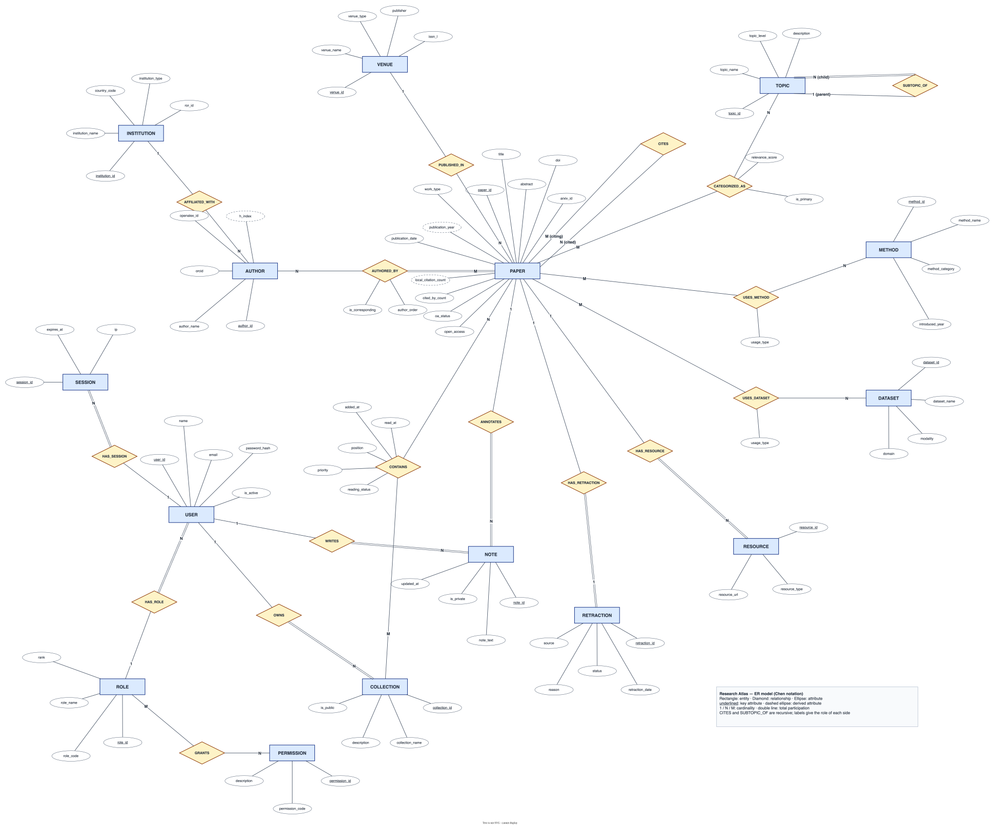
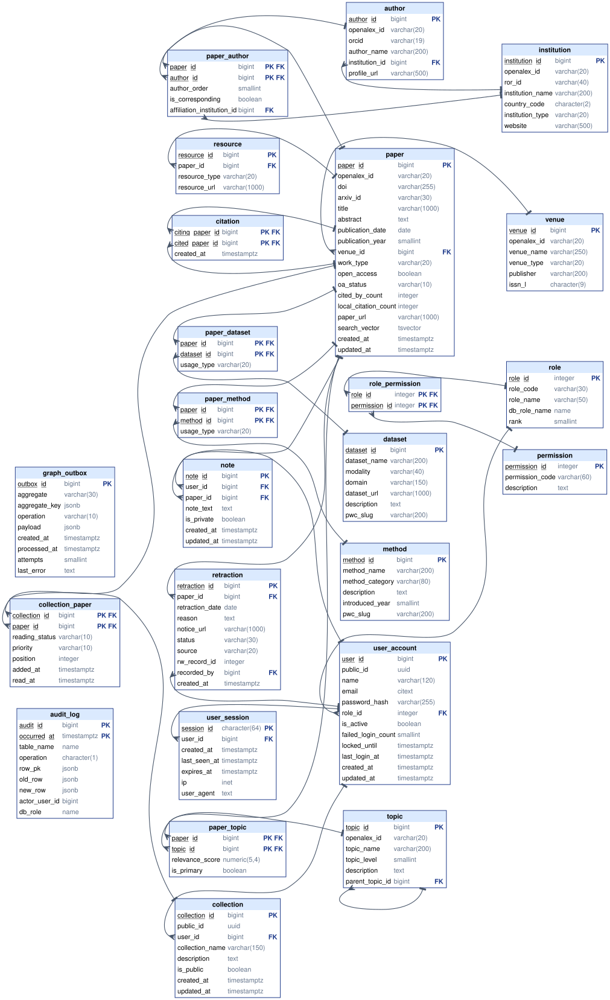
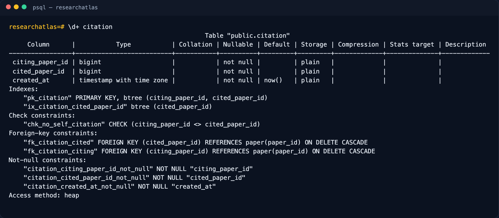
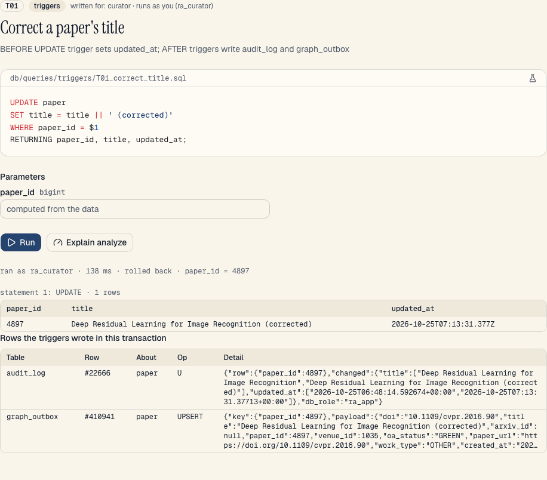
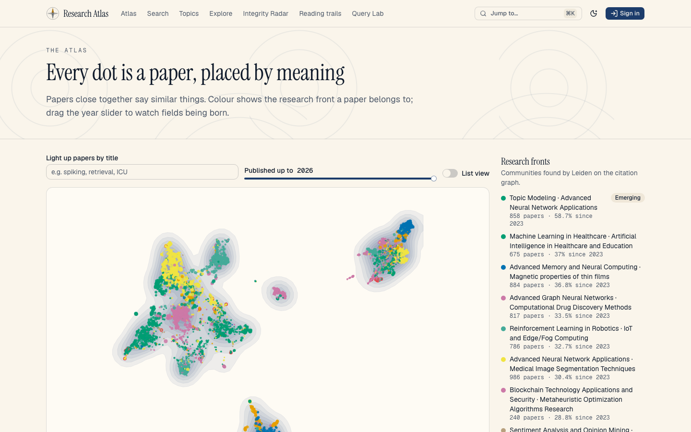
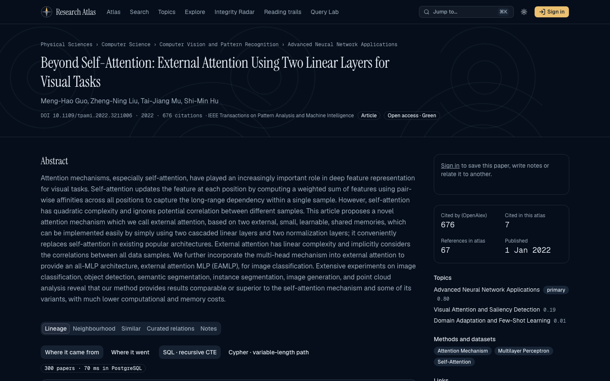
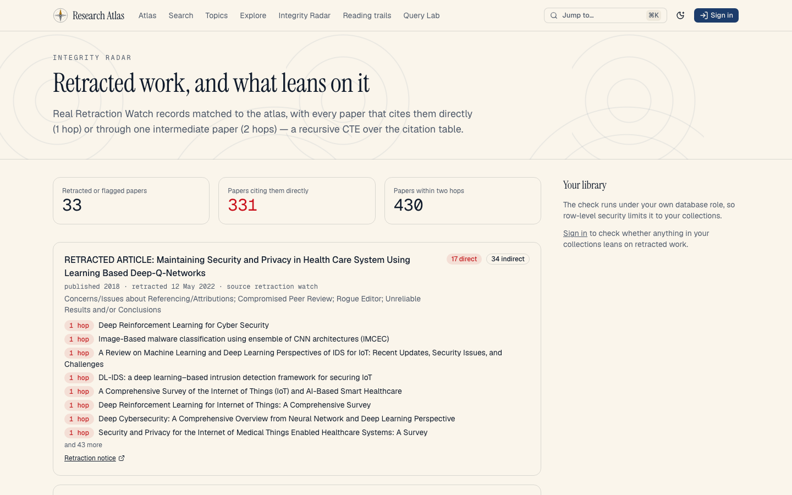
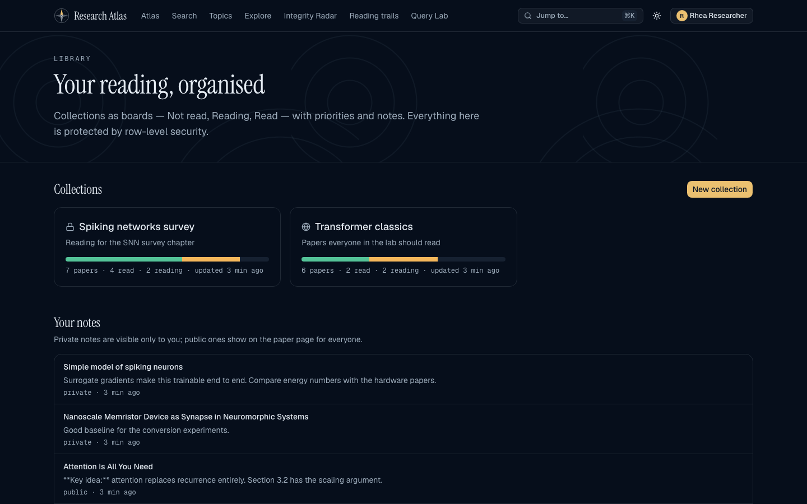
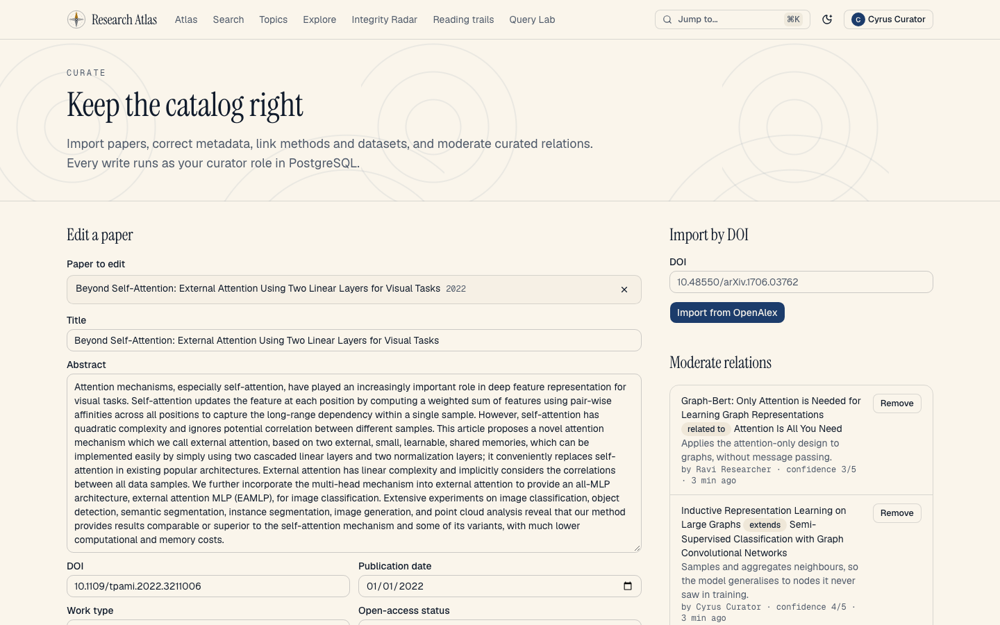
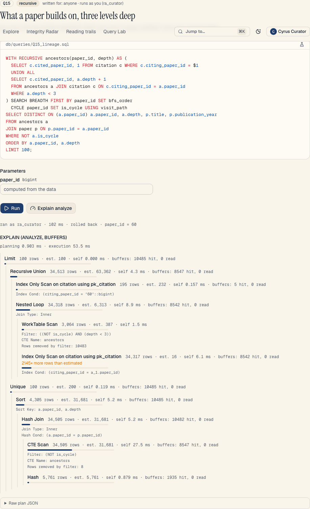

<!-- Generated by pnpm docs:report from report.src.md and the chapters in docs/. Do not edit by hand. -->

PES University · Department of Computer Science and Engineering

Database Management System · Aug–Dec 2026 · Experiential Learning Level 3 mini-project

# Research Atlas

**See how an idea travelled: a map of research papers, their citations, topics and lineage**

Daruru Bhuvan Sai · Deeptanshu Kumar

Repository: `github.com/DBS13062006/research-atlas`

@body

# 1. Abstract

Research Atlas is a research-discovery platform built on two databases. PostgreSQL 18 is the system of
record for 5,761 real papers in six themes (spiking networks, transformers, graph learning, vision,
clinical machine learning and reinforcement learning), their 77,024 in-corpus citations, 24,736 authors,
the four-level OpenAlex topic hierarchy, methods and datasets from the Papers with Code archive, and 33
Retraction Watch records. Its rules live in the database: 125 named constraints, 18 functions, 8
procedures, 30 triggers (11 trigger functions), 3 views and 2 materialized views, and role-based access with forced row-level
security, so every request runs under the caller's own PostgreSQL role. Neo4j 2026.09 holds the same
catalog as a knowledge graph, fed by a transactional outbox, with a 768-dimension vector index over local
EmbeddingGemma embeddings, graph algorithms (ArticleRank, Leiden, betweenness), and two graph-native
features with full read, update and delete: reading trails and curated relations. A Next.js 16.4
application and a 66-endpoint REST API are the only way in. A Query Lab runs every catalog query, DML
statement, constraint proof, routine and trigger demo live, with plans. 361 pgTAP tests, 327 Vitest
tests and 67 browser tests verify it.

# 2. Problem and objectives

## Problem

A researcher entering a field faces thousands of papers and no map. Search engines answer “which papers
mention X”, but not the questions that matter when learning a field: where did this idea come from, what
did it lead to, how are two papers connected, which work is quietly influential, and does anything I rely
on lean on retracted research?

Research Atlas answers those questions over a real corpus of 5,761 papers (spiking neural networks,
transformers, graph learning, vision, clinical machine learning and reinforcement learning) with their
77,024 in-corpus citations, 24,736 authors, the OpenAlex topic hierarchy, methods and datasets from the
Papers with Code archive, and 33 Retraction Watch records.

## Objectives

1. Model the domain properly: a Chen ER model mapped to a BCNF relational schema in which every rule is
   a named constraint or trigger.
2. Exercise the full range of SQL: DDL with constraints, every DML form, joins, nested and correlated
   subqueries, recursive CTEs, analytics, procedures, functions, triggers and views.
3. Enforce authentication and role-based access **inside PostgreSQL**, with GRANTs and row-level
   security, not only in application code.
4. Add a NoSQL and vector store that does what SQL does poorly — graph algorithms, vector search,
   graph-native data — and keep it consistent without dual writes.
5. Build a usable, accessible application and API over both, and prove everything with automated tests.

## Use cases

| #    | Use case                             | Actor               | Main flow                                                                                         | Database features exercised                                                                  |
| ---- | ------------------------------------ | ------------------- | ------------------------------------------------------------------------------------------------- | -------------------------------------------------------------------------------------------- |
| UC1  | Find papers                          | Anyone              | Type a query; compare lexical, semantic and hybrid rankings                                       | full-text search (`fn_search_papers`), Neo4j vector index, Reciprocal Rank Fusion            |
| UC2  | Trace an idea                        | Anyone              | Pick a paper; see what it builds on and what built on it, by year and hop                         | recursive CTE with `SEARCH`/`CYCLE` (`fn_paper_lineage`); Cypher variable-length path        |
| UC3  | Connect two papers                   | Anyone              | Pick two papers; see the shortest citation chain                                                  | breadth-first recursive CTE with a path array; Cypher `SHORTEST`                             |
| UC4  | Explore a field                      | Anyone              | Browse domain → field → subfield → topic; growth per year                                         | self-referencing table, recursive CTE, `fn_topic_growth`, materialized views                 |
| UC5  | Spot research fronts and hidden gems | Anyone              | Ranked communities and under-cited influential papers                                             | Graph Data Science: Leiden, ArticleRank                                                      |
| UC6  | Check integrity                      | Anyone / researcher | See retracted papers and what cites them within two hops; check one's own library                 | recursive CTE, `v_retraction_exposure`, RLS-scoped query                                     |
| UC7  | Sign up and sign in                  | Visitor             | Create an account; sign in; lockout after five failures                                           | `sp_register_user`, Argon2id, hashed session tokens, `SECURITY DEFINER` auth functions       |
| UC8  | Organise reading                     | Researcher          | Collections as boards (Not read, Reading, Read), priorities, notes                                | RLS on collections and notes, triggers stamping `read_at`, `sp_add_to_collection`            |
| UC9  | Curate relations and trails          | Researcher          | Assert “A extends B”; build an ordered reading trail                                              | graph-native data in Neo4j with full read, update and delete                                 |
| UC10 | Keep the catalog right               | Curator             | Import by DOI; correct metadata; link methods and datasets; moderate relations                    | `sp_import_paper` (MERGE), CHECK constraints, audit and outbox triggers                      |
| UC11 | Run the atlas                        | Administrator       | Change roles, deactivate users, read the audit trail, sync the graph, refresh analytics           | `sp_set_user_role`, last-admin trigger, partitioned `audit_log`, `pg_stat_statements`        |
| UC12 | Inspect the database live            | Researcher and up   | Run any catalog query, DML, constraint proof, routine or trigger demo; see plans and side effects | Query Lab: role-scoped execution, `EXPLAIN ANALYZE`, `fn_lab_side_effects`, Cypher `PROFILE` |

# 3. ER diagram (rubric 1)



## Relationships

| Relationship            | Entities             | Cardinality | Participation           | Attributes                                            | Why                                                    |
| ----------------------- | -------------------- | ----------- | ----------------------- | ----------------------------------------------------- | ------------------------------------------------------ |
| AFFILIATED_WITH         | AUTHOR – INSTITUTION | N : 1       | partial both            | —                                                     | An author's current institution may be unknown         |
| PUBLISHED_IN            | PAPER – VENUE        | N : 1       | partial both            | —                                                     | Preprints may have no venue                            |
| AUTHORED_BY             | PAPER – AUTHOR       | M : N       | total on PAPER          | author_order, is_corresponding                        | Every paper has at least one author; position matters  |
| CITES (recursive)       | PAPER – PAPER        | M : N       | partial                 | —                                                     | Roles _citing_ and _cited_; a paper cannot cite itself |
| CATEGORIZED_AS          | PAPER – TOPIC        | M : N       | partial                 | relevance_score, is_primary                           | OpenAlex scores each topic                             |
| SUBTOPIC_OF (recursive) | TOPIC – TOPIC        | N : 1       | total on non-root child | —                                                     | Only domains (level 0) have no parent                  |
| USES_METHOD             | PAPER – METHOD       | M : N       | partial                 | usage_type                                            | Proposed, used, compared, extended, baseline           |
| USES_DATASET            | PAPER – DATASET      | M : N       | partial                 | usage_type                                            | Training, validation, testing, benchmarking            |
| HAS_RESOURCE            | PAPER – RESOURCE     | 1 : N       | total on RESOURCE       | —                                                     | A resource without a paper is meaningless              |
| HAS_RETRACTION          | PAPER – RETRACTION   | 1 : 0..1    | total on RETRACTION     | —                                                     | One retraction record per paper at most                |
| HAS_ROLE                | USER – ROLE          | N : 1       | total on USER           | —                                                     | Every account has exactly one role                     |
| GRANTS                  | ROLE – PERMISSION    | M : N       | partial                 | —                                                     | The permission matrix                                  |
| HAS_SESSION             | USER – SESSION       | 1 : N       | total on SESSION        | —                                                     | Several devices at once                                |
| OWNS                    | USER – COLLECTION    | 1 : N       | total on COLLECTION     | —                                                     | Collections belong to someone                          |
| CONTAINS                | COLLECTION – PAPER   | M : N       | partial                 | reading_status, priority, position, added_at, read_at | The Kanban board                                       |
| WRITES                  | USER – NOTE          | 1 : N       | total on NOTE           | —                                                     |                                                        |
| ANNOTATES               | NOTE – PAPER         | N : 1       | total on NOTE           | —                                                     | A note is always about one paper                       |

## Cardinality and participation decisions

- **AUTHORED_BY is total on PAPER** but not on AUTHOR: an author record can outlive its last paper (for
  example after a merge), while a paper without authors is a data error. The database enforces the paper
  side when papers are imported through `sp_import_paper`.
- **CITES is M:N and recursive.** The two roles become `citing_paper_id` and `cited_paper_id` in the
  relational schema, and `chk_no_self_citation` forbids the reflexive case.
- **SUBTOPIC_OF is total on non-root children.** A CHECK constraint ties the parent to the level
  (`chk_topic_only_domains_are_roots`) and a trigger refuses cycles and level inversions.
- **HAS_RETRACTION is 1 : 0..1**, which becomes a foreign key plus `UNIQUE (paper_id)` on `retraction`.
- **Derived attributes** are drawn dashed. `publication_year` is a virtual generated column;
  `local_citation_count` is kept exact by a statement-level trigger; `h_index` is computed by
  `fn_author_h_index` and cached in a materialized view. Chapter 4 explains why these two stored values do not
  break normal form.

# 4. Relational schema (rubric 2)

The 15 entities and 17 relationships map to 24 tables: 22 domain tables plus `audit_log` and
`graph_outbox`. The diagram below is generated from the live database.



## Mapping rules used

| ER construct                                   | Relational mapping                                                                        | Example                                                                    |
| ---------------------------------------------- | ----------------------------------------------------------------------------------------- | -------------------------------------------------------------------------- |
| Strong entity                                  | Table with a surrogate `BIGINT GENERATED ALWAYS AS IDENTITY` key                          | `paper(paper_id)`                                                          |
| N:1 relationship                               | Foreign key on the N side                                                                 | `paper.venue_id → venue`                                                   |
| 1:N relationship with total participation on N | `NOT NULL` foreign key on the N side                                                      | `resource.paper_id NOT NULL`                                               |
| 1:0..1 relationship                            | Foreign key plus `UNIQUE`                                                                 | `retraction.paper_id UNIQUE`                                               |
| M:N relationship                               | Link table whose primary key is both foreign keys; relationship attributes become columns | `paper_author(paper_id, author_id, author_order, …)`                       |
| Recursive M:N (CITES)                          | Link table with two foreign keys to the same table and role-named columns                 | `citation(citing_paper_id, cited_paper_id)`                                |
| Recursive N:1 (SUBTOPIC_OF)                    | Self-referencing foreign key                                                              | `topic.parent_topic_id → topic`                                            |
| Derived attribute                              | Generated column or trigger-maintained column                                             | `paper.publication_year` (VIRTUAL), `paper.local_citation_count` (trigger) |

## Keys

- **Surrogate keys everywhere.** `GENERATED ALWAYS AS IDENTITY` (SQL standard) instead of `SERIAL`: the
  sequence belongs to the column, and a client cannot accidentally insert its own id without
  `OVERRIDING SYSTEM VALUE`.
- **Natural keys kept as alternate keys.** `doi`, `openalex_id`, `arxiv_id`, `orcid`, `ror_id`,
  `issn_l` are each `UNIQUE` and nullable, because a paper may lack a DOI but two papers may never share one.
- **Public identifiers.** `user_account.public_id` and `collection.public_id` are `uuidv7()` values
  (PostgreSQL 18). They appear in URLs instead of sequential ids, which would leak how many users exist;
  v7 UUIDs are time-ordered, so their B-tree index stays compact.
- **Composite keys on link tables.** `paper_author(paper_id, author_id)`, `citation(citing_paper_id,
  cited_paper_id)`, `collection_paper(collection_id, paper_id)` and so on: a pair can appear only once.
- **Second candidate key.** `paper_author(paper_id, author_order)` is also unique (`uq_paper_author_order`),
  declared `DEFERRABLE INITIALLY IMMEDIATE` so two authors can swap positions in one transaction.

## Delete rules

| Situation                                                                 | Rule                                                                                                              | Reason                                                                                                |
| ------------------------------------------------------------------------- | ----------------------------------------------------------------------------------------------------------------- | ----------------------------------------------------------------------------------------------------- |
| A paper is deleted                                                        | `CASCADE` to authorships, citations, topic/method/dataset links, resources, retraction, notes, collection entries | These facts mean nothing without the paper                                                            |
| A shared catalog row (author, topic, method, dataset) is still referenced | `RESTRICT` (SQLSTATE 23001)                                                                                       | Silently losing curated links is worse than an error; admins merge duplicates with `sp_merge_authors` |
| A venue or institution is deleted                                         | `SET NULL`                                                                                                        | The paper or author stays valid without it                                                            |
| A user is deleted                                                         | `CASCADE` to sessions, collections, notes; `SET NULL` on `retraction.recorded_by`                                 | Personal data goes; integrity records stay                                                            |
| A role still has users                                                    | `RESTRICT`                                                                                                        | Every user must keep a valid role                                                                     |

# 5. Normalization

## Method

1. Atomic values only (1NF): no column stores a list. Authors, topics, methods and datasets of a paper
   live in link tables, not in comma-separated text.
2. For each table, write down the FDs implied by the real-world rules, not just by the keys.
3. Confirm every determinant is a superkey (BCNF ⇒ 3NF ⇒ 2NF).

## Every table

| Table            | Candidate keys                                              | Non-trivial FDs (determinant → dependents)                  | BCNF |
| ---------------- | ----------------------------------------------------------- | ----------------------------------------------------------- | ---- |
| role             | {role_id}, {role_code}, {role_name}, {db_role_name}, {rank} | each key → all other columns                                | ✓    |
| permission       | {permission_id}, {permission_code}                          | key → description                                           | ✓    |
| role_permission  | {role_id, permission_id}                                    | none (all-key)                                              | ✓    |
| user_account     | {user_id}, {public_id}, {email}                             | key → name, password_hash, role_id, flags, timestamps       | ✓    |
| user_session     | {session_id}                                                | session_id → user_id, timestamps, ip, user_agent            | ✓    |
| institution      | {institution_id}, {openalex_id}, {ror_id}                   | key → name, country_code, type, website                     | ✓    |
| author           | {author_id}, {openalex_id}, {orcid}                         | key → author_name, institution_id, profile_url              | ✓    |
| venue            | {venue_id}, {openalex_id}, {issn_l}                         | key → venue_name, venue_type, publisher                     | ✓    |
| paper            | {paper_id}, {openalex_id}, {doi}, {arxiv_id}                | key → title, abstract, dates, venue_id, OA fields, counts   | ✓*   |
| paper_author     | {paper_id, author_id}, {paper_id, author_order}             | see 4.2                                                     | ✓    |
| citation         | {citing_paper_id, cited_paper_id}                           | key → created_at                                            | ✓    |
| topic            | {topic_id}, {openalex_id}, {parent_topic_id, topic_name}    | key → level, description                                    | ✓    |
| paper_topic      | {paper_id, topic_id}                                        | key → relevance_score, is_primary                           | ✓    |
| method           | {method_id}, {method_name}, {pwc_slug}                      | key → category, description, introduced_year                | ✓    |
| paper_method     | {paper_id, method_id}                                       | key → usage_type                                            | ✓    |
| dataset          | {dataset_id}, {dataset_name}, {pwc_slug}                    | key → modality, domain, url, description                    | ✓    |
| paper_dataset    | {paper_id, dataset_id}                                      | key → usage_type                                            | ✓    |
| resource         | {resource_id}, {paper_id, resource_type, resource_url}      | resource_id → paper_id, type, url                           | ✓    |
| retraction       | {retraction_id}, {paper_id}, {rw_record_id}                 | key → date, reason, notice, status, source, recorded_by     | ✓    |
| collection       | {collection_id}, {public_id}, {user_id, collection_name}    | key → description, is_public, timestamps                    | ✓    |
| collection_paper | {collection_id, paper_id}                                   | key → reading_status, priority, position, added_at, read_at | ✓    |
| note             | {note_id}                                                   | note_id → user_id, paper_id, text, flags, timestamps        | ✓    |
| audit_log        | {audit_id, occurred_at}                                     | key → table_name, operation, row images, actor, db_role     | ✓    |
| graph_outbox     | {outbox_id}                                                 | outbox_id → aggregate, key, operation, payload, status      | ✓    |

\* apart from the two derived columns below.

`collection_paper.read_at` and `reading_status` look dependent on each other, but neither determines the
other's value (a READ entry can have any timestamp), so there is no FD between them; the CHECK
`chk_collection_paper_read_at_matches_status` only constrains which combinations are legal.

## The two deliberate denormalizations

| Column                       | Derived from                                   | Why store it                                                                                                       | How drift is prevented                                                                                                  |
| ---------------------------- | ---------------------------------------------- | ------------------------------------------------------------------------------------------------------------------ | ----------------------------------------------------------------------------------------------------------------------- |
| `paper.local_citation_count` | `count(*)` of `citation` rows citing the paper | Ranking and list pages sort by it on every request; counting thousands of citation rows per page would be wasteful | Statement-level triggers on `citation` with transition tables update it once per statement, inside the same transaction |
| `paper.search_vector`        | `title` and `abstract`                         | Full-text search needs an indexed `tsvector`                                                                       | `GENERATED ALWAYS AS (…) STORED`: the database recomputes it on every write; it cannot be written directly              |

`paper.publication_year` is also derived, but it is a `VIRTUAL` generated column (PostgreSQL 18): it is
computed on read and never stored, so it introduces no redundancy at all.

# 6. DDL with constraints (rubric 3)

## Migrations

| Migration | Purpose |
| --- | --- |
| [`001_extensions.sql`](../../db/migrations/001_extensions.sql) | Extensions used by the schema: case-insensitive email, trigram search, query statistics. |
| [`005_owner.sql`](../../db/migrations/005_owner.sql) | Database roles. ra_owner owns every schema object; later migrations switch to it with SET ROLE so ownership never sits with the superuser. BYPASSRLS lets SECURITY DEFINER functions owned by it read tables whose row-level security is FORCED. The four group roles form the application privilege ladder; their grants live in 300_rbac. Roles are cluster-wide, so creation is idempotent (the test database shares the cluster). |
| [`010_rbac_tables.sql`](../../db/migrations/010_rbac_tables.sql) | Access-control and account tables. |
| [`020_catalog_tables.sql`](../../db/migrations/020_catalog_tables.sql) | The research catalog: institutions, authors, venues, papers and everything linked to them. |
| [`030_user_content_tables.sql`](../../db/migrations/030_user_content_tables.sql) | Content owned by individual users: collections, their papers, and notes. |
| [`040_system_tables.sql`](../../db/migrations/040_system_tables.sql) | System tables: the partitioned audit trail and the transactional outbox that feeds Neo4j. |
| [`050_indexes.sql`](../../db/migrations/050_indexes.sql) | Indexes beyond keys. PostgreSQL does not index foreign-key columns automatically; every FK not led by a primary key gets one so joins and ON DELETE checks stay fast. |
| [`200_functions.sql`](../../db/migrations/200_functions.sql) | Functions. Each one exists because a feature needs it; see docs/08-advanced-sql.md. |
| [`210_procedures.sql`](../../db/migrations/210_procedures.sql) | Stored procedures. Business operations that must happen as one unit live in the database, so every client (web app, API, scripts, psql) gets the same rules. |
| [`220_triggers.sql`](../../db/migrations/220_triggers.sql) | Triggers. Rules a CHECK cannot express (they read other rows or tables), derived columns, the audit trail and the outbox that keeps Neo4j in step with PostgreSQL. |
| [`230_views.sql`](../../db/migrations/230_views.sql) | Views and materialized views. Plain views use security_invoker so row-level security is evaluated for the caller, not for the view owner. |
| [`300_rbac.sql`](../../db/migrations/300_rbac.sql) | Role-based access control enforced by PostgreSQL itself. |
| [`310_admin_stats.sql`](../../db/migrations/310_admin_stats.sql) | Administrators may read query statistics (pg_stat_statements) for every role, which the admin page uses to list the slowest queries. pg_read_all_stats is a predefined read-only role. |
| [`320_display_names.sql`](../../db/migrations/320_display_names.sql) | Public display names. Trails and curated relations live in Neo4j and record only the author's user_id. user_account is behind forced RLS, so this narrow SECURITY DEFINER function returns the one column that is safe to show next to public content: the name. No email, no role. |
| [`330_lab_side_effects.sql`](../../db/migrations/330_lab_side_effects.sql) | Query Lab side effects. After a lab run (always inside a transaction), the lab shows the audit_log and graph_outbox rows that the run's triggers wrote. Only administrators may read those tables, so this SECURITY DEFINER function returns exactly the rows created by the caller's own current transaction (xmin = its transaction id) and nothing older or anyone else's. |
| [`900_reference_seed.sql`](../../db/migrations/900_reference_seed.sql) | Reference data every installation needs: the three application roles, the permission vocabulary, and which role holds which permission. Higher roles hold everything lower roles do. |

## Constraints, indexes and triggers

The schema has 125 named constraints, 28 secondary indexes and 30 triggers; chapter 5 of the
documentation lists every one with its definition. The psql snapshot below shows one table as PostgreSQL describes it.



## Triggers (30)

| Table | Trigger | When | Function |
| --- | --- | --- | --- |
| author | `trg_graph_outbox` | AFTER INSERT OR UPDATE OR DELETE · row | `fn_graph_outbox` |
| citation | `trg_citation_count_del` | AFTER DELETE · statement | `fn_citation_count_del` |
| citation | `trg_citation_count_ins` | AFTER INSERT · statement | `fn_citation_count_ins` |
| citation | `trg_citation_count_upd` | AFTER UPDATE · statement | `fn_citation_count_upd` |
| citation | `trg_graph_outbox` | AFTER INSERT OR UPDATE OR DELETE · row | `fn_graph_outbox` |
| collection | `trg_audit` | AFTER INSERT OR UPDATE OR DELETE · row | `fn_audit` |
| collection | `trg_set_updated_at` | BEFORE UPDATE · row | `fn_set_updated_at` |
| collection_paper | `trg_reading_status_read_at` | BEFORE INSERT OR UPDATE · row | `fn_reading_status_read_at` |
| dataset | `trg_graph_outbox` | AFTER INSERT OR UPDATE OR DELETE · row | `fn_graph_outbox` |
| institution | `trg_graph_outbox` | AFTER INSERT OR UPDATE OR DELETE · row | `fn_graph_outbox` |
| method | `trg_graph_outbox` | AFTER INSERT OR UPDATE OR DELETE · row | `fn_graph_outbox` |
| note | `trg_note_owner_immutable` | BEFORE UPDATE · row | `fn_note_owner_immutable` |
| note | `trg_set_updated_at` | BEFORE UPDATE · row | `fn_set_updated_at` |
| paper | `trg_audit` | AFTER INSERT OR UPDATE OR DELETE · row | `fn_audit` |
| paper | `trg_graph_outbox` | AFTER INSERT OR UPDATE OR DELETE · row | `fn_graph_outbox` |
| paper | `trg_set_updated_at` | BEFORE UPDATE · row | `fn_set_updated_at` |
| paper_author | `trg_graph_outbox` | AFTER INSERT OR UPDATE OR DELETE · row | `fn_graph_outbox` |
| paper_dataset | `trg_graph_outbox` | AFTER INSERT OR UPDATE OR DELETE · row | `fn_graph_outbox` |
| paper_method | `trg_graph_outbox` | AFTER INSERT OR UPDATE OR DELETE · row | `fn_graph_outbox` |
| paper_topic | `trg_graph_outbox` | AFTER INSERT OR UPDATE OR DELETE · row | `fn_graph_outbox` |
| retraction | `trg_audit` | AFTER INSERT OR UPDATE OR DELETE · row | `fn_audit` |
| retraction | `trg_graph_outbox` | AFTER INSERT OR UPDATE OR DELETE · row | `fn_graph_outbox` |
| retraction | `trg_retraction_date_guard` | BEFORE INSERT OR UPDATE · row | `fn_retraction_date_guard` |
| role_permission | `trg_audit` | AFTER INSERT OR UPDATE OR DELETE · row | `fn_audit` |
| topic | `trg_graph_outbox` | AFTER INSERT OR UPDATE OR DELETE · row | `fn_graph_outbox` |
| topic | `trg_topic_hierarchy_guard` | BEFORE INSERT OR UPDATE · row | `fn_topic_hierarchy_guard` |
| user_account | `trg_audit` | AFTER INSERT OR UPDATE OR DELETE · row | `fn_audit` |
| user_account | `trg_protect_last_admin` | BEFORE UPDATE OR DELETE · row | `fn_protect_last_admin` |
| user_account | `trg_set_updated_at` | BEFORE UPDATE · row | `fn_set_updated_at` |
| venue | `trg_graph_outbox` | AFTER INSERT OR UPDATE OR DELETE · row | `fn_graph_outbox` |

## Constraint proofs

Each proof is an action the database must refuse. They run live in the Query Lab and as pgTAP tests.

### P01 · A paper cites itself

**Technique:** CHECK constraint across two columns · **runs as** `ra_curator` · [`proofs/P01_self_citation.sql`](../../db/queries/proofs/P01_self_citation.sql)

Parameters (computed from the data): `paper_id` = 1

```sql
INSERT INTO citation (citing_paper_id, cited_paper_id) VALUES ($1, $1);
```

**Refused, as intended,** by `chk_no_self_citation`:

```text
new row for relation "citation" violates check constraint "chk_no_self_citation"
```

### P09 · A researcher tries to record a retraction

**Technique:** GRANT-based access control: ra_researcher has no INSERT on retraction (SQLSTATE 42501) · **runs as** `ra_researcher` · [`proofs/P09_researcher_records_retraction.sql`](../../db/queries/proofs/P09_researcher_records_retraction.sql)

Parameters (computed from the data): `paper_id` = 1

```sql
INSERT INTO retraction (paper_id, retraction_date, status) VALUES ($1, CURRENT_DATE, 'RETRACTED');
```

**Refused, as intended,** by SQLSTATE `42501`:

```text
permission denied for table retraction
```

# 7. NoSQL and vector database creation (rubric 4)

## Graph model

| Node label      | Key              | Count  | Source                                                                                                           |
| --------------- | ---------------- | ------ | ---------------------------------------------------------------------------------------------------------------- |
| `Paper`         | `paperId`        | 5,761  | projected from `paper` (+ `embedding`, `umapX/umapY`, `articleRank`, `community`, `betweenness` written by jobs) |
| `Author`        | `authorId`       | 24,736 | projected from `author`                                                                                          |
| `Institution`   | `institutionId`  | 2,941  | projected                                                                                                        |
| `Venue`         | `venueId`        | 1,135  | projected                                                                                                        |
| `Topic`         | `topicId`        | 1,189  | projected                                                                                                        |
| `Method`        | `methodId`       | 160    | projected                                                                                                        |
| `Dataset`       | `datasetId`      | 60     | projected                                                                                                        |
| `Trail`         | `trailId` (UUID) | 2      | **graph-native**                                                                                                 |
| `EmbeddingMeta` | `name`           | 1      | records the embedding model                                                                                      |

| Relationship                                                                                                         | From → to              | Count        | Source                                                   |
| -------------------------------------------------------------------------------------------------------------------- | ---------------------- | ------------ | -------------------------------------------------------- |
| `CITES`                                                                                                              | Paper → Paper          | 77,024       | projected from `citation`                                |
| `AUTHORED {order, isCorresponding}`                                                                                  | Author → Paper         | 34,617       | projected from `paper_author`                            |
| `AFFILIATED_WITH`                                                                                                    | Author → Institution   | 22,788       | projected                                                |
| `BELONGS_TO_TOPIC {score, isPrimary}`                                                                                | Paper → Topic          | 17,283       | projected                                                |
| `SUBTOPIC_OF`                                                                                                        | Topic → Topic          | 1,185        | projected                                                |
| `USES_METHOD`, `USES_DATASET {usage}`                                                                                | Paper → Method/Dataset | 10,937 / 879 | projected                                                |
| `PUBLISHED_IN`                                                                                                       | Paper → Venue          | 5,681        | projected                                                |
| `COAUTHOR {papers}`                                                                                                  | Author → Author        | 157,150      | **derived** from AUTHORED                                |
| `SIMILAR_TO {score, model}`                                                                                          | Paper → Paper          | 56,594       | **derived** from the vector index (top 10, score ≥ 0.75) |
| `STEP {position, annotation}`                                                                                        | Trail → Paper          | 9            | **graph-native**                                         |
| `EXTENDS`, `IMPROVES_UPON`, `CONTRADICTS`, `REPLICATES`, `RELATED_TO` `{relationId, note, confidence, createdBy, …}` | Paper → Paper          | 5            | **graph-native** curated relations                       |

Counts are from the loaded corpus on 25 October 2026.

## Schema

[`graph/schema.cypher`](../../graph/schema.cypher) is applied by `pnpm graph:schema`. Every statement is
idempotent (`IF NOT EXISTS`):
- **9 uniqueness constraints**, one per node key (they also create the lookup indexes);
- **range indexes** on `Paper.year`, `Paper.community`, `Paper.articleRank`, `Trail.ownerId`,
  `Topic.level`, `STEP.position`, and on `relationId` for each curated relationship type;
- **full-text indexes** on paper titles and author names;
- a **vector index** on `Paper.embedding`:

```cypher
CREATE VECTOR INDEX paper_embedding IF NOT EXISTS
FOR (p:Paper) ON p.embedding
WITH [p.year, p.isRetracted]
OPTIONS { indexConfig: { `vector.dimensions`: 768, `vector.similarity_function`: 'cosine' } };
```

`year` and `isRetracted` are declared as filter properties, so a `SEARCH … WHERE p.year >= 2020` filters
inside the index rather than after it. Embeddings are stored as `LIST<FLOAT>`: the native `VECTOR` type
needs the block store format, which Neo4j Community does not offer. `SHOW INDEXES` (catalog query C01, and
the Cypher Lab) lists all of them.

## Keeping Neo4j consistent: the transactional outbox

Writing to two databases from the application ("dual writes") loses data whenever one write succeeds and
the other fails. Instead:
1. An `AFTER INSERT OR UPDATE OR DELETE` trigger (`trg_graph_outbox`) on every projected table inserts a
   row into `graph_outbox` **in the same transaction** as the change, then calls `pg_notify`. If the
   transaction rolls back, so does the outbox row. Updates that change nothing are skipped.
2. `drainOutbox` ([`src/server/graph/projection.ts`](../../src/server/graph/projection.ts)) reads pending rows
   in id order with `FOR UPDATE SKIP LOCKED`, groups consecutive rows of the same table and operation into
   one `UNWIND` batch, applies the matching Cypher, and marks them processed. A failing group records the
   error and stops the drain, so a later change never overtakes an earlier one.
3. The web app drains right after each write; `pnpm graph:sync` drains on demand; the admin console shows
   pending and failing rows and has a “Sync graph now” button.
4. Derived `COAUTHOR` edges are refreshed for exactly the authors whose authorships changed.
5. `pnpm graph:rebuild` wipes the projected part and reloads it from PostgreSQL (5.6 s), keeping
   graph-native data and job-owned properties. `pnpm graph:check` compares 17 counts between the two
   databases, the derived co-authorship included, and fails on any drift.

The model is _eventually consistent_: the graph trails PostgreSQL by at most one drain, and can always be
rebuilt from it.

# 8. Technology justification (rubric 5)

## ADR 1 · PostgreSQL 18 rather than the 19 release candidate

**Context.** The course is graded on SQL depth; the database must be stable for months of development and
a live demo. **Options.** PostgreSQL 18 (current stable); PostgreSQL 19 (release candidate, with SQL/PGQ
graph queries planned). **Decision.** PostgreSQL 18. **Consequences.** We use 18's new features where they
help — `uuidv7()`, virtual generated columns, `RETURNING old.* / new.*` (D05), `MERGE … RETURNING
merge_action()` (D08) — and do graph work in Neo4j instead of a release candidate's preview feature.

## ADR 2 · Neo4j as the NoSQL store, rather than MongoDB or pgvector alone

**Context.** The NoSQL part must add capabilities the relational model lacks, with real read, update and
delete. **Options.** MongoDB (documents); pgvector inside PostgreSQL; Neo4j (property graph with a native
vector index and a graph-algorithms library). **Decision.** Neo4j. **Consequences.** One engine gives
multi-hop traversal, `SHORTEST` paths, vector `SEARCH` with in-index filters, and ArticleRank/Leiden/
betweenness. Documents would have duplicated the relational data without adding a new kind of query, and
pgvector alone would cover similarity but not the graph algorithms. The cost is a second store to keep
consistent, solved with the outbox (chapter 9).

## ADR 3 · SQL first, no ORM

**Context.** Evaluators must see the SQL. **Options.** Prisma or Drizzle; postgres.js tagged templates with
migrations in plain SQL. **Decision.** postgres.js and dbmate. **Consequences.** Every query is visible SQL,
parameterised by the tagged template (no string concatenation). Business rules live in the database as
constraints, functions, procedures and triggers, where an ORM would have pulled them into application code.

## ADR 4 · Our own session authentication rather than an auth library

**Context.** Authentication and role-based access are graded inside the database. **Options.** Better
Auth or Auth.js; sessions written by hand following the Copenhagen Book. **Decision.** Our own: Argon2id
passwords, 256-bit tokens stored as SHA-256 hashes, lockout, renewal. **Consequences.** The schema keeps
our `user_account`, `role`, `permission` and `user_session` tables, the session functions are
`SECURITY DEFINER` and testable in pgTAP, and every request runs under a PostgreSQL role. We own the
security code, so it is covered by unit, integration and end-to-end tests.

## ADR 5 · Local embeddings with Ollama rather than a paid API

**Context.** Semantic search needs embeddings for 5,761 papers and for every query. **Options.** A hosted
embedding API; SPECTER2 (science-tuned, Python only); EmbeddingGemma through Ollama. **Decision.** Ollama
`embeddinggemma`, with a Transformers.js build of the same model as a fallback. **Consequences.** No cost,
no key, no data leaving the laptop; the corpus embeds in under two minutes on the GPU; results on our
probe queries are on topic (chapter 9). The fallback agrees with Ollama at cosine 0.996.

# 9. DML (rubric 6)

Ten DML files, one per technique. Each ran as its declared role inside a transaction that was rolled
back, so the outputs are real but changed nothing.

## D05 · Raise a priority and show the before and after values

**Technique:** UPDATE ... RETURNING old.* and new.* (PostgreSQL 18) · **runs as** `ra_researcher` · [`dml/D05_priority_before_after.sql`](../../db/queries/dml/D05_priority_before_after.sql)

Parameters (computed from the data): `collection_id` = 26

```sql
UPDATE collection_paper
SET priority = CASE priority WHEN 'LOW' THEN 'MEDIUM' ELSE 'HIGH' END
WHERE collection_id = $1
RETURNING paper_id, old.priority AS priority_before, new.priority AS priority_after;
```

| paper_id | priority_before | priority_after |
| --- | --- | --- |
| 1 | LOW | MEDIUM |
| 4933 | MEDIUM | HIGH |
| 4934 | HIGH | HIGH |
| 4975 | HIGH | HIGH |
| 5021 | HIGH | HIGH |

_7 rows; the first 5 are shown._

## D07 · Delete a paper and show what cascaded

**Technique:** ON DELETE CASCADE across seven child tables, row counts before and after · **runs as** `ra_admin` · [`dml/D07_delete_paper_cascade.sql`](../../db/queries/dml/D07_delete_paper_cascade.sql)

Parameters (computed from the data): `paper_id` = 4897

```sql
CREATE TEMP TABLE before_counts ON COMMIT DROP AS
SELECT 'paper_author' AS child, count(*) AS n FROM paper_author WHERE paper_id = $1
UNION ALL SELECT 'citation', count(*) FROM citation WHERE $1 IN (citing_paper_id, cited_paper_id)
UNION ALL SELECT 'paper_topic', count(*) FROM paper_topic WHERE paper_id = $1
UNION ALL SELECT 'paper_method', count(*) FROM paper_method WHERE paper_id = $1
UNION ALL SELECT 'paper_dataset', count(*) FROM paper_dataset WHERE paper_id = $1
UNION ALL SELECT 'resource', count(*) FROM resource WHERE paper_id = $1
UNION ALL SELECT 'collection_paper', count(*) FROM collection_paper WHERE paper_id = $1;
DELETE FROM paper WHERE paper_id = $1;
SELECT b.child,
       b.n AS rows_before,
       CASE b.child
         WHEN 'paper_author' THEN (SELECT count(*) FROM paper_author WHERE paper_id = $1)
         WHEN 'citation' THEN (SELECT count(*) FROM citation WHERE $1 IN (citing_paper_id, cited_paper_id))
         WHEN 'paper_topic' THEN (SELECT count(*) FROM paper_topic WHERE paper_id = $1)
         WHEN 'paper_method' THEN (SELECT count(*) FROM paper_method WHERE paper_id = $1)
         WHEN 'paper_dataset' THEN (SELECT count(*) FROM paper_dataset WHERE paper_id = $1)
         WHEN 'resource' THEN (SELECT count(*) FROM resource WHERE paper_id = $1)
         WHEN 'collection_paper' THEN (SELECT count(*) FROM collection_paper WHERE paper_id = $1)
       END AS rows_after
FROM before_counts b;
```

| child | rows_before | rows_after |
| --- | --- | --- |
| paper_author | 4 | 0 |
| citation | 852 | 0 |
| paper_topic | 3 | 0 |
| paper_method | 3 | 0 |
| paper_dataset | 3 | 0 |

_7 rows; the first 5 are shown._

## D08 · Sync a subfield's topics from a staging table

**Technique:** MERGE with WHEN MATCHED, WHEN NOT MATCHED and WHEN NOT MATCHED BY SOURCE, RETURNING merge_action() · **runs as** `ra_curator` · [`dml/D08_merge_topics.sql`](../../db/queries/dml/D08_merge_topics.sql)

Parameters (computed from the data): `subfield_id` = 5

```sql
CREATE TEMP TABLE topic_staging (topic_name TEXT PRIMARY KEY, description TEXT) ON COMMIT DROP;
-- The latest taxonomy keeps two existing topics (with new descriptions) and adds one new topic.
INSERT INTO topic_staging
SELECT topic_name, 'Description refreshed from the latest taxonomy'
FROM topic WHERE parent_topic_id = $1 ORDER BY topic_id LIMIT 2;
INSERT INTO topic_staging VALUES ('Neuro-symbolic Reasoning', 'Added by the latest taxonomy');
MERGE INTO topic t
USING topic_staging s
ON t.parent_topic_id = $1 AND t.topic_name = s.topic_name
WHEN MATCHED THEN
  UPDATE SET description = s.description
WHEN NOT MATCHED THEN
  INSERT (topic_name, topic_level, parent_topic_id, description) VALUES (s.topic_name, 3, $1, s.description)
WHEN NOT MATCHED BY SOURCE AND t.parent_topic_id = $1 THEN
  UPDATE SET description = 'Not in the latest taxonomy'
RETURNING merge_action() AS action, t.topic_id, t.topic_name, t.description;
```

| action | topic_id | topic_name | description |
| --- | --- | --- | --- |
| UPDATE | 7 | Low-power high-performance VLSI design | Description refreshed from the latest taxonomy |
| UPDATE | 8 | Advanced Memory and Neural Computing | Description refreshed from the latest taxonomy |
| UPDATE | 16 | Ferroelectric and Negative Capacitance Devices | Not in the latest taxonomy |
| UPDATE | 24 | CCD and CMOS Imaging Sensors | Not in the latest taxonomy |
| UPDATE | 68 | Organic Electronics and Photovoltaics | Not in the latest taxonomy |

_63 rows; the first 5 are shown._

## D09 · Swap two authors' positions safely

**Technique:** SAVEPOINT, SET CONSTRAINTS ... DEFERRED on a DEFERRABLE UNIQUE constraint, RELEASE SAVEPOINT · **runs as** `ra_curator` · [`dml/D09_swap_author_order.sql`](../../db/queries/dml/D09_swap_author_order.sql)

Parameters (computed from the data): `paper_id` = 1

```sql
SAVEPOINT before_swap;
-- Positions 1 and 2 would collide halfway through; deferring the check to the end of the
-- transaction lets both rows move.
SET CONSTRAINTS uq_paper_author_order DEFERRED;
UPDATE paper_author SET author_order = 3 - author_order WHERE paper_id = $1 AND author_order IN (1, 2);
SET CONSTRAINTS uq_paper_author_order IMMEDIATE;
RELEASE SAVEPOINT before_swap;
SELECT pa.author_order, a.author_name
FROM paper_author pa JOIN author a ON a.author_id = pa.author_id
WHERE pa.paper_id = $1
ORDER BY pa.author_order;
```

| author_order | author_name |
| --- | --- |
| 1 | Narayan Srinivasa |
| 2 | Mike Davies |
| 3 | Gautham N. Chinya |
| 4 | Yongqiang Cao |
| 5 | Sri Harsha Choday |

_19 rows; the first 5 are shown._

# 10. Nested, correlated, recursive and join queries (rubric 7)

Twenty-five queries: seven joins, six nested and correlated, four recursive, and analytics, set
operations, JSON and search. All 25 with outputs and plans are in chapter 7 of the documentation; a
representative set follows. Outputs are from the loaded corpus.

## Joins

### Q03 · Which methods are benchmarked on which datasets, including unpaired ones

**Technique:** FULL OUTER JOIN keeps methods with no dataset and datasets with no method · **runs as** `ra_anon` · [`Q03_method_dataset_pairs.sql`](../../db/queries/Q03_method_dataset_pairs.sql)

```sql
WITH used_together AS (
  SELECT pm.method_id, pd.dataset_id, count(DISTINCT pm.paper_id) AS papers
  FROM paper_method pm
  JOIN paper_dataset pd ON pd.paper_id = pm.paper_id
  GROUP BY pm.method_id, pd.dataset_id
), methods AS (
  SELECT m.method_id, m.method_name, u.dataset_id, u.papers
  FROM method m
  LEFT JOIN used_together u ON u.method_id = m.method_id
)
SELECT coalesce(methods.method_name, '— no method —') AS method,
       coalesce(d.dataset_name, '— no dataset —') AS dataset,
       coalesce(methods.papers, 0) AS papers
FROM methods
FULL OUTER JOIN dataset d ON d.dataset_id = methods.dataset_id
ORDER BY papers DESC, method, dataset;
```

| method | dataset | papers |
| --- | --- | --- |
| Convolution | COCO | 64 |
| Convolution | ImageNet | 61 |
| Convolutional Neural Network | ImageNet | 58 |
| Softmax | ImageNet | 58 |
| Residual Connection | COCO | 57 |

_1168 rows; the first 5 are shown._

**Plan:** Sort · planning 0.10 ms · execution 2.22 ms · operators: Sort, Hash Join, Aggregate, Seq Scan on paper_method, Hash, Seq Scan on paper_dataset, Seq Scan on method, Seq Scan on dataset

### Q04 · Top 3 papers in every leaf topic

**Technique:** CROSS JOIN LATERAL with ORDER BY ... LIMIT inside, per-group top-N · **runs as** `ra_anon` · [`Q04_top3_per_topic.sql`](../../db/queries/Q04_top3_per_topic.sql)

```sql
SELECT t.topic_name, top3.title, top3.cited_by_count
FROM topic t
CROSS JOIN LATERAL (
  SELECT p.title, p.cited_by_count
  FROM paper_topic pt
  JOIN paper p ON p.paper_id = pt.paper_id
  WHERE pt.topic_id = t.topic_id
  ORDER BY p.cited_by_count DESC, p.paper_id
  LIMIT 3
) AS top3
WHERE t.topic_level = 3
ORDER BY t.topic_name, top3.cited_by_count DESC;
```

| topic_name | title | cited_by_count |
| --- | --- | --- |
| 2D Materials and Applications | Electric Field Effect in Atomically Thin Carbon Films | 66784 |
| 2D Materials and Applications | Two-dimensional materials for next-generation computing technologies | 1047 |
| 2D Materials and Applications | Multi-terminal memtransistors from polycrystalline monolayer molybden… | 1025 |
| 3D IC and TSV technologies | Three-dimensional integration of nanotechnologies for computing and d… | 865 |
| 3D IC and TSV technologies | Neurocube | 342 |

_2053 rows; the first 5 are shown._

**Plan:** Sort · planning 0.11 ms · execution 14.95 ms · operators: Sort, Nested Loop, Seq Scan on topic, Limit, Bitmap Heap Scan on paper_topic, Bitmap Index Scan using ix_paper_topic_topic_id, Index Scan using pk_paper

## Nested and correlated

### Q09 · Authors active in every year 2021-2024

**Technique:** relational division, double NOT EXISTS, generate_series · **runs as** `ra_anon` · [`Q09_active_every_year.sql`](../../db/queries/Q09_active_every_year.sql)

```sql
SELECT a.author_id, a.author_name
FROM author a
WHERE NOT EXISTS (
  SELECT 1 FROM generate_series(2021, 2024) AS y(yr)
  WHERE NOT EXISTS (
    SELECT 1
    FROM paper_author pa
    JOIN paper p USING (paper_id)
    WHERE pa.author_id = a.author_id
      AND p.publication_date >= make_date(y.yr, 1, 1)
      AND p.publication_date < make_date(y.yr + 1, 1, 1)))
ORDER BY a.author_name;
```

| author_id | author_name |
| --- | --- |
| 989 | Bai Tao Sun |
| 11088 | Demis Hassabis |
| 9455 | Deng-Ping Fan |
| 6958 | Fahad Shahbaz Khan |
| 991 | Guangdong Zhou |

_29 rows; the first 5 are shown._

**Plan:** Sort · planning 0.13 ms · execution 61.01 ms · operators: Sort, Nested Loop, Seq Scan on author, Function Scan, Index Scan using ix_paper_author_author_id, Index Scan using pk_paper

## Recursive

### Q15 · What a paper builds on, three levels deep

**Technique:** recursive CTE with SEARCH BREADTH FIRST and CYCLE clauses, DISTINCT ON for the shortest depth · **runs as** `ra_anon` · [`Q15_lineage.sql`](../../db/queries/Q15_lineage.sql)

Parameters (computed from the data): `paper_id` = 60

```sql
WITH RECURSIVE ancestors(paper_id, depth) AS (
  SELECT c.cited_paper_id, 1 FROM citation c WHERE c.citing_paper_id = $1
  UNION ALL
  SELECT c.cited_paper_id, a.depth + 1
  FROM ancestors a JOIN citation c ON c.citing_paper_id = a.paper_id
  WHERE a.depth < 3
) SEARCH BREADTH FIRST BY paper_id SET bfs_order
  CYCLE paper_id SET is_cycle USING visit_path
SELECT DISTINCT ON (a.paper_id) a.paper_id, a.depth, p.title, p.publication_year
FROM ancestors a
JOIN paper p ON p.paper_id = a.paper_id
WHERE NOT a.is_cycle
ORDER BY a.paper_id, a.depth
LIMIT 100;
```

| paper_id | depth | title | publication_year |
| --- | --- | --- | --- |
| 1 | 2 | Loihi: A Neuromorphic Manycore Processor with On-Chip Learning | 2018 |
| 2 | 1 | Training and operation of an integrated neuromorphic network based on… | 2015 |
| 4 | 1 | Memristors with diffusive dynamics as synaptic emulators for neuromor… | 2016 |
| 7 | 2 | The future of electronics based on memristive systems | 2017 |
| 8 | 1 | Organic electrochemical transistors | 2018 |

_100 rows; the first 5 are shown._

**Plan:** Limit · planning 0.11 ms · execution 28.18 ms · operators: Limit, Recursive Union, Index Only Scan using pk_citation, Nested Loop, WorkTable Scan, Unique, Sort, Hash Join, …

### Q16 · Shortest citation path between two papers

**Technique:** breadth-first recursive CTE carrying a path array, stops at the first depth that reaches the target · **runs as** `ra_anon` · [`Q16_shortest_citation_path.sql`](../../db/queries/Q16_shortest_citation_path.sql)

Parameters (computed from the data): `from_id` = 1, `to_id` = 4897

```sql
WITH RECURSIVE walk(paper_id, depth, path) AS (
  SELECT $1::BIGINT, 0, ARRAY[$1::BIGINT]
  UNION ALL
  SELECT c.cited_paper_id, w.depth + 1, w.path || c.cited_paper_id
  FROM walk w
  JOIN citation c ON c.citing_paper_id = w.paper_id
  WHERE w.depth < 4
    AND NOT c.cited_paper_id = ANY (w.path)
    AND w.paper_id <> $2
), hits AS (
  SELECT path, depth FROM walk WHERE paper_id = $2
)
SELECT h.depth AS hops,
       (SELECT string_agg(p.title, '  →  ' ORDER BY u.ord)
        FROM unnest(h.path) WITH ORDINALITY AS u(paper_id, ord)
        JOIN paper p ON p.paper_id = u.paper_id) AS chain
FROM hits h
WHERE h.depth = (SELECT min(depth) FROM hits)
LIMIT 3;
```

| hops | chain |
| --- | --- |
| 3 | Loihi: A Neuromorphic Manycore Processor with On-Chip Learning → Even… |
| 3 | Loihi: A Neuromorphic Manycore Processor with On-Chip Learning → Even… |
| 3 | Loihi: A Neuromorphic Manycore Processor with On-Chip Learning → Even… |

**Plan:** Limit · planning 0.07 ms · execution 0.94 ms · operators: Limit, Recursive Union, Result, Nested Loop, WorkTable Scan, Index Only Scan using pk_citation, CTE Scan, Aggregate, …

## Analytics

### Q20 · Papers by field and year with subtotals

**Technique:** GROUPING SETS with a grand total, GROUPING() to label subtotal rows · **runs as** `ra_anon` · [`Q20_topic_year_rollup.sql`](../../db/queries/Q20_topic_year_rollup.sql)

```sql
SELECT CASE WHEN grouping(f.topic_name) = 1 THEN 'All fields' ELSE f.topic_name END AS field,
       CASE WHEN grouping(p.publication_year) = 1 THEN 'All years' ELSE p.publication_year::TEXT END AS year,
       count(DISTINCT p.paper_id) AS papers
FROM paper p
JOIN paper_topic pt ON pt.paper_id = p.paper_id AND pt.is_primary
JOIN topic t ON t.topic_id = pt.topic_id
JOIN topic sf ON sf.topic_id = t.parent_topic_id
JOIN topic f ON f.topic_id = sf.parent_topic_id
WHERE p.publication_date >= make_date(EXTRACT(YEAR FROM now())::INT - 5, 1, 1)
GROUP BY GROUPING SETS ((f.topic_name, p.publication_year), (f.topic_name), ())
ORDER BY grouping(f.topic_name), field, grouping(p.publication_year), year;
```

| field | year | papers |
| --- | --- | --- |
| Agricultural and Biological Sciences | 2021 | 1 |
| Agricultural and Biological Sciences | 2022 | 2 |
| Agricultural and Biological Sciences | 2023 | 8 |
| Agricultural and Biological Sciences | 2024 | 6 |
| Agricultural and Biological Sciences | 2025 | 2 |

_109 rows; the first 5 are shown._

**Plan:** Sort · planning 0.17 ms · execution 3.31 ms · operators: Sort, Aggregate, Hash Join, Index Scan using uq_one_primary_topic, Hash, Seq Scan on paper, Seq Scan on topic

# 11. Procedures, functions, triggers and CTEs (rubric 8)

## Functions

| Function                                           | Returns                                            | Technique                                                                 | Used by                         | Tests                      |
| -------------------------------------------------- | -------------------------------------------------- | ------------------------------------------------------------------------- | ------------------------------- | -------------------------- |
| `app_current_user_id()`                            | bigint                                             | `current_setting('app.user_id', true)`, `STABLE`                          | RLS policies, audit, procedures | `20_functions`             |
| `fn_has_permission(user_id, code)`                 | boolean                                            | four-table join, `SECURITY DEFINER`                                       | procedures, UI gating           | `20_functions`             |
| `fn_topic_path(topic_id)`                          | text                                               | recursive CTE up the tree, `string_agg … ORDER BY depth DESC`             | breadcrumbs, `v_paper_card`     | `20_functions`             |
| `fn_topic_descendants(topic_id)`                   | table(topic_id, depth)                             | recursive CTE down the tree                                               | topic pages, `fn_topic_growth`  | `20_functions`             |
| `fn_paper_lineage(paper_id, direction, max_depth)` | table(paper_id, depth, path)                       | recursive CTE with `SEARCH BREADTH FIRST` and `CYCLE`, `DISTINCT ON`      | Lineage view, API               | `20_functions`             |
| `fn_author_h_index(author_id)`                     | int                                                | `row_number()` window                                                     | author page, `mv_author_stats`  | `20_functions`, `50_views` |
| `fn_search_papers(query, limit, offset)`           | table(paper_id, title, rank, headline, matched_by) | `websearch_to_tsquery`, `ts_rank_cd`, `ts_headline`, trigram fallback     | lexical search                  | `20_functions`             |
| `fn_retraction_exposure(paper_id)`                 | table(retracted_paper_id, hops, path)              | recursive CTE limited to 2 hops, joined to `retraction`                   | Integrity Radar                 | `20_functions`             |
| `fn_topic_growth(topic_id, from, to)`              | table(year, papers, yoy_pct)                       | `generate_series` fills empty years, `LAG()`                              | Research fronts, Q19            | `20_functions`             |
| `fn_ensure_audit_partition(ts)`                    | text                                               | dynamic DDL with `format('%I', …)`                                        | audit partitions                | migration                  |
| `fn_user_display_names(ids)`                       | table(user_id, name)                               | narrow `SECURITY DEFINER` read past forced RLS: names only                | trail and relation bylines      | `60_rbac`                  |
| `fn_lab_side_effects()`                            | table(source, row_id, target, operation, detail)   | rows whose `xmin` is the current transaction, with a changed-columns diff | Query Lab trigger demos         | `40_triggers`              |

### The lineage walk

```sql
WITH RECURSIVE walk(paper_id, depth, path) AS (
  SELECT c.cited_paper_id, 1, ARRAY[p_paper_id]
  FROM citation c WHERE c.citing_paper_id = p_paper_id
  UNION ALL
  SELECT c.cited_paper_id, w.depth + 1, w.path || w.paper_id
  FROM walk w JOIN citation c ON c.citing_paper_id = w.paper_id
  WHERE w.depth < least(p_max_depth, 6)
) SEARCH BREADTH FIRST BY paper_id SET bfs_order
  CYCLE paper_id SET is_cycle USING visit_path
SELECT DISTINCT ON (walk.paper_id) walk.paper_id, walk.depth, walk.path || walk.paper_id
FROM walk WHERE NOT walk.is_cycle AND walk.paper_id <> p_paper_id
ORDER BY walk.paper_id, walk.depth, walk.bfs_order;
```

_Termination:_ the recursive term stops producing rows once `depth` reaches the limit; the `CYCLE`
clause additionally marks a row whose `paper_id` already appears on its own path, so a citation loop
cannot recurse forever. `SEARCH BREADTH FIRST` orders the rows level by level, and `DISTINCT ON` keeps
each paper once, at the shallowest depth at which it was reached.

### Authentication functions (SECURITY DEFINER)

`fn_auth_lookup`, `fn_session_user`, `fn_record_login_failure`, `fn_record_login_success`,
`fn_session_extend` and `fn_session_delete` are the only way to read password hashes or touch
`user_session`. They are owned by `ra_owner`, run with `SET search_path = pg_catalog, public` so a
caller cannot shadow a table with one of their own, return only the columns the login flow needs, and
are granted narrowly: the two readers to `ra_anon`, the writers only to `ra_app` itself (chapter 10).

## Procedures

| Procedure                                                       | What it does                  | Technique                                                                                                        | Tests                        |
| --------------------------------------------------------------- | ----------------------------- | ---------------------------------------------------------------------------------------------------------------- | ---------------------------- |
| `sp_register_user(name, email, hash, role_code, INOUT user_id)` | creates an account            | custom SQLSTATE `RA001` for a duplicate email; only `users:manage` may create non-researchers                    | `30_procedures`              |
| `sp_import_paper(payload, INOUT paper_id)`                      | upserts a whole OpenAlex work | `MERGE … RETURNING merge_action()`, data-modifying CTEs over `jsonb_to_recordset`, idempotent                    | `30_procedures` (3 fixtures) |
| `sp_retract_paper(paper_id, date, status, reason, url)`         | records a retraction          | `INSERT … ON CONFLICT DO UPDATE`; date-guard, audit and outbox triggers fire; `RAISE NOTICE` with exposure count | `30_procedures`, `60_rbac`   |
| `sp_merge_authors(keep_id, dup_id)`                             | folds a duplicate author      | `SELECT … FOR UPDATE` in id order (deadlock-safe), `DELETE … USING`                                              | `30_procedures`              |
| `sp_add_to_collection(collection_id, paper_id, priority)`       | appends a paper               | position = max + 1; ownership proven by RLS `WITH CHECK`                                                         | `30_procedures`              |
| `sp_set_user_role(user_id, role_code)`                          | changes a role                | permission check, then `trg_protect_last_admin`                                                                  | `30_procedures`              |
| `sp_refresh_analytics()`                                        | refreshes both MVs            | `REFRESH MATERIALIZED VIEW CONCURRENTLY` (needs the unique indexes)                                              | `30_procedures`, `60_rbac`   |
| `sp_purge_expired_sessions(INOUT deleted)`                      | deletes expired sessions      | data-modifying CTE `DELETE … RETURNING` counted                                                                  | `30_procedures`              |

**Why `sp_merge_authors` cannot deadlock.** Two administrators merging the same pair in opposite
directions would, with naive locking, each lock one row and wait for the other. Locking both rows with
`ORDER BY author_id FOR UPDATE` makes every caller acquire the locks in the same order, so the second
caller simply waits for the first to finish.

## Triggers

| Trigger                            | Table · timing · level                                                                                             | Purpose                                                                                   | Tests                          |
| ---------------------------------- | ------------------------------------------------------------------------------------------------------------------ | ----------------------------------------------------------------------------------------- | ------------------------------ |
| `trg_set_updated_at`               | user_account, paper, collection, note · BEFORE UPDATE · row (with `WHEN (OLD IS DISTINCT FROM NEW)` where allowed) | keeps `updated_at` honest                                                                 | `40_triggers`                  |
| `trg_retraction_date_guard`        | retraction · BEFORE INSERT OR UPDATE OF retraction_date, paper_id · row                                            | rejects a retraction dated before publication (23514) — a CHECK cannot read another table | `40_triggers`                  |
| `trg_topic_hierarchy_guard`        | topic · BEFORE INSERT OR UPDATE OF parent_topic_id, topic_level · row                                              | child level = parent level + 1; no cycles (recursive walk)                                | `40_triggers`                  |
| `trg_citation_count_ins/_del/_upd` | citation · AFTER · **statement**, with transition tables                                                           | one aggregated UPDATE per statement keeps `local_citation_count` exact                    | `40_triggers`                  |
| `trg_reading_status_read_at`       | collection_paper · BEFORE INSERT OR UPDATE OF reading_status · row                                                 | sets or clears `read_at`                                                                  | `40_triggers`                  |
| `trg_protect_last_admin`           | user_account · BEFORE UPDATE OF role_id, is_active OR DELETE · row                                                 | never leaves zero active admins (`RA002`)                                                 | `40_triggers`, `30_procedures` |
| `trg_note_owner_immutable`         | note · BEFORE UPDATE OF user_id, paper_id · row                                                                    | a note cannot move to another user or paper                                               | `40_triggers`                  |
| `trg_audit`                        | paper, retraction, user_account, role_permission, collection · AFTER I/U/D · row                                   | writes `audit_log` with before/after images, minus `password_hash`                        | `40_triggers`                  |
| `trg_graph_outbox`                 | 13 catalog tables · AFTER I/U/D · row                                                                              | writes `graph_outbox` and `pg_notify('graph_outbox', id)`                                 | `40_triggers`                  |

### Row-level versus statement-level

A row-level trigger runs once per affected row; a statement-level trigger runs once per statement.
Loading 5,000 citations with one `INSERT … SELECT` would run a row-level counter 5,000 times, each an
`UPDATE paper`. The statement-level version sees all inserted rows at once through the transition table
`new_rows` and does a single grouped update:

```sql
CREATE TRIGGER trg_citation_count_ins AFTER INSERT ON citation
  REFERENCING NEW TABLE AS new_rows FOR EACH STATEMENT EXECUTE FUNCTION fn_citation_count_ins();

UPDATE paper p SET local_citation_count = p.local_citation_count + d.n
FROM (SELECT cited_paper_id, count(*) AS n FROM new_rows GROUP BY cited_paper_id) d
WHERE p.paper_id = d.cited_paper_id;
```

`40_triggers.sql` asserts that after inserts, deletes and an update, every stored count equals the real
count.

### The outbox and why there are no dual writes

If the web app wrote to PostgreSQL and then to Neo4j, a crash between the two writes would leave them
inconsistent. Instead the triggers write an outbox row **in the same transaction** as the change; if the
transaction rolls back, so does the outbox row. A worker (`pnpm graph:sync`) replays pending rows into
Neo4j with idempotent `MERGE` statements and marks them processed (chapter 9).

## Views and materialized views

| View                    | Kind                                | Notes                                                                                                                                         |
| ----------------------- | ----------------------------------- | --------------------------------------------------------------------------------------------------------------------------------------------- |
| `v_paper_card`          | view, `security_invoker`            | paper + venue + ordered author list (`LATERAL` + `string_agg … ORDER BY author_order`) + primary topic path + retraction status               |
| `v_retraction_exposure` | view, `security_invoker`, recursive | papers citing retracted work within two hops                                                                                                  |
| `v_my_library`          | view, `security_invoker`            | caller's collections with counts per reading status via `count(*) FILTER (…)`                                                                 |
| `mv_topic_year_stats`   | materialized                        | papers, citations and open-access share per topic and year over each topic's subtree (recursive closure); unique index for concurrent refresh |
| `mv_author_stats`       | materialized                        | papers, citations, h-index, first and last year per author                                                                                    |

**View versus materialized view.** A view is a stored query, recomputed on every read, so it is always
current. A materialized view stores its result; reads are fast but the data is as old as the last
refresh. `REFRESH MATERIALIZED VIEW CONCURRENTLY` rebuilds it without locking out readers by computing
the new result and applying the difference row by row — which needs a unique index to match old and
new rows.

**`security_invoker`.** By default a view runs with its owner's privileges, so row-level security on the
underlying tables would be evaluated for `ra_owner` (who bypasses it). `security_invoker = true` makes
PostgreSQL evaluate permissions and policies for the caller, so `v_my_library` returns different rows
for different users.

## CTE patterns used

| Pattern                                            | Where                                            |
| -------------------------------------------------- | ------------------------------------------------ |
| Recursive CTE down a tree                          | `fn_topic_descendants`, Q14                      |
| Recursive CTE up a tree                            | `fn_topic_path`, `trg_topic_hierarchy_guard`     |
| Recursive CTE over a graph with `SEARCH` / `CYCLE` | `fn_paper_lineage`, Q15                          |
| Breadth-first shortest path with a path array      | Q16                                              |
| Recursive transitive closure                       | `mv_topic_year_stats`                            |
| Data-modifying CTE (`DELETE … RETURNING` counted)  | `sp_purge_expired_sessions`, `fn_session_delete` |
| Non-recursive CTE chains for readability           | Q03, `fn_topic_growth`                           |

## Triggers at work

Correcting a paper's title in the Query Lab (demo T01, as a curator). Below the result are the
`audit_log` and `graph_outbox` rows the triggers wrote in the same transaction, which was then rolled
back.



# 12. NoSQL and vector features with read, update and delete (rubric 9)

## Vector search

Each paper is embedded with Ollama's `embeddinggemma` (768 dimensions) using the model's document prompt,
`title: {title} | text: {abstract}`; a search query uses `task: search result | query: {q}`. Vectors are
cached on disk by a hash of the text, so re-running `pnpm embed:papers` only embeds what changed (5,761
papers took 106 s on the laptop's GPU). A Transformers.js build of the same model is the fallback provider;
its vectors agree with Ollama's at cosine 0.996.

Similar papers (catalog query C02):

```cypher
CYPHER 25
MATCH (seed:Paper {paperId: $paper_id})
MATCH (p:Paper)
  SEARCH p IN (VECTOR INDEX paper_embedding FOR seed.embedding WHERE p.year >= 2020 LIMIT 11) SCORE AS score
WITH seed, p, score WHERE p <> seed
RETURN p.paperId AS paperId, p.title AS title, p.year AS year, round(score, 3) AS score
ORDER BY score DESC LIMIT 10
```

**Hybrid search** runs PostgreSQL full-text search and the vector search side by side and fuses the two
rankings with Reciprocal Rank Fusion, score = Σ 1 / (60 + rank). The search page shows each hit's rank in
both lists.

### Probe results

The five probe queries from the plan, top five hits each (`pnpm embed:papers --probe`):

| Query                             | Top hits (cosine similarity)                                                                                                                                                                                                                                                                                                                                                                                          |
| --------------------------------- | --------------------------------------------------------------------------------------------------------------------------------------------------------------------------------------------------------------------------------------------------------------------------------------------------------------------------------------------------------------------------------------------------------------------- |
| spiking neurons energy efficiency | 0.819 Spike-based dynamic computing with asynchronous sensing-computing neuromorphic chip · 0.811 Accurate and efficient time-domain classification with adaptive spiking recurrent neural networks · 0.809 High-performance deep spiking neural networks with 0.3 spikes per neuron · 0.808 Spiking Neural Networks and Their Applications: A Review · 0.802 A 4-fJ/Spike Artificial Neuron in 65 nm CMOS Technology |
| retrieval augmented generation    | 0.823 Retrieval-Augmented Generation for AI-Generated Content: A Survey · 0.805 Retrieval-Augmented Generation for Large Language Models: A Survey · 0.800 Retrieval-augmented generation for educational application · 0.787 Hallucination Mitigation for Retrieval-Augmented LLMs · 0.782 Graph Retrieval-Augmented Generation: A Survey                                                                            |
| graph attention                   | 0.816 Attention-based Graph Neural Network for Semi-supervised Learning · 0.815 Understanding Attention and Generalization in GNNs · 0.813 Graph Attention Networks · 0.812 How to Find Your Friendly Neighborhood · 0.807 How Attentive are Graph Attention Networks?                                                                                                                                                |
| ICU mortality prediction          | 0.837 Prediction model of in-hospital mortality in ICU patients with heart failure · 0.830 Predicting Mortality in ICU Patients With Heart Failure · 0.827 Dynamic and explainable ML prediction of mortality in ICU patients · 0.821 Prognostic Assessment of COVID-19 in the ICU · 0.811 Using ML to Predict ICU Transfer in COVID-19 Patients                                                                      |
| offline reinforcement learning    | 0.877 Offline RL: Tutorial, Review, and Perspectives on Open Problems · 0.861 A Survey on Offline RL · 0.834 Conservative Q-Learning for Offline RL · 0.825 Off-Policy Deep RL without Exploration · 0.824 MOPO: Model-based Offline Policy Optimization                                                                                                                                                              |

Every hit is on topic, including papers whose titles share no words with the query.

## Graph algorithms (`pnpm graph:analytics`)

| Job                 | Algorithm (GDS)                                                                       | Written to                  | Used by                                                 |
| ------------------- | ------------------------------------------------------------------------------------- | --------------------------- | ------------------------------------------------------- |
| Influence           | ArticleRank on the citation graph                                                     | `Paper.articleRank`         | Hidden gems (influential but under-cited), ranking      |
| Research fronts     | Leiden on the undirected citation graph, fixed seed: 125 communities, modularity 0.62 | `Paper.community`           | Atlas colours, Research fronts page                     |
| Brokers             | Betweenness centrality (sampled)                                                      | `Paper.betweenness`         | Bridges query (C08)                                     |
| Co-authorship       | Cypher aggregation over shared papers                                                 | `COAUTHOR {papers}`         | Author network, “people you may collaborate with” (C05) |
| Semantic neighbours | Top 10 vector neighbours, score ≥ 0.75                                                | `SIMILAR_TO {score, model}` | Similar tab on paper pages                              |

`pnpm layout:umap` projects the embeddings to two dimensions with a seeded UMAP, so the map is identical
on every rebuild.

## Read, update and delete on graph-native data

Neo4j Community has no fine-grained access control, so ownership is enforced in the Cypher itself: the
creator may change a relation or trail, and so may a curator (relations) or an administrator (trails).
Every path is covered by integration tests in
[`tests/integration/graph-native.test.ts`](../../tests/integration/graph-native.test.ts).

### Curated relations

| Operation | API                                                               | Cypher idea                                                                                                        |
| --------- | ----------------------------------------------------------------- | ------------------------------------------------------------------------------------------------------------------ |
| Create    | `POST /api/v1/papers/{id}/relations`                              | `MATCH` both papers, `CREATE (a)-[:EXTENDS {relationId: $id, …}]->(b)` with a UUID made by the server              |
| Read      | `GET /api/v1/papers/{id}/relations`, `GET /api/v1/relations/{id}` | match by `relationId`, either direction                                                                            |
| Update    | `PATCH /api/v1/relations/{id}`                                    | note and confidence in place; a type change recreates the relationship with the same id (Cypher cannot retype one) |
| Delete    | `DELETE /api/v1/relations/{id}`                                   | `WHERE r.createdBy = $userId OR $isCurator … DELETE r`                                                             |

Update in place (catalog query C11):

```cypher
MATCH (:Paper)-[r {relationId: $relation_id}]->(:Paper)
WHERE r.createdBy = $user_id OR $is_curator
SET r.note = 'Confirmed after reading section 4', r.confidence = 5, r.updatedAt = datetime()
RETURN r.relationId AS relationId, type(r) AS relation, r.note AS note, r.confidence AS confidence
```

### Reading trails

A trail is a `Trail` node with ordered `STEP {position, annotation}` relationships to papers.

| Operation | API                                                                                               | Notes                                                                                            |
| --------- | ------------------------------------------------------------------------------------------------- | ------------------------------------------------------------------------------------------------ |
| Create    | `POST /api/v1/trails`, `POST /api/v1/trails/{id}/steps`                                           | positions assigned in order                                                                      |
| Read      | `GET /api/v1/trails`, `GET /api/v1/trails/{id}`                                                   | private trails are invisible (404, not 403) to others                                            |
| Update    | `PATCH /api/v1/trails/{id}` (title, visibility), `PATCH …/steps/{position}` (annotation), reorder | reorder rewrites all positions in one transaction and rejects an order that is not a permutation |
| Delete    | `DELETE …/steps/{position}`, `DELETE /api/v1/trails/{id}`                                         | removing a step closes the gap                                                                   |

Remove step 2 and close the gap (C12):

```cypher
MATCH (t:Trail {trailId: $trail_id})-[s:STEP {position: 2}]->()
DELETE s
WITH t
MATCH (t)-[rest:STEP]->(p:Paper) WHERE rest.position > 2
SET rest.position = rest.position - 1
```

## The same question in both databases

The Lineage and Connect pages answer each question twice and show both timings:

| Question                                      | PostgreSQL                                                                                      | Neo4j                                            |
| --------------------------------------------- | ----------------------------------------------------------------------------------------------- | ------------------------------------------------ |
| What does this paper build on, 3 levels deep? | recursive CTE with `SEARCH BREADTH FIRST` and `CYCLE` (`fn_paper_lineage`), 300 papers in 76 ms | variable-length `(p)-[:CITES]->{1,3}(q)`, 128 ms |
| Shortest citation chain between two papers    | breadth-first recursive CTE carrying the path as an array (Q16)                                 | `SHORTEST 1 (a)-[:CITES]-+(b)` (C03)             |

At this size PostgreSQL is competitive on traversals; Neo4j earns its place with the vector index, the graph
algorithms and the graph-native features, which would be awkward or impossible in SQL alone.

# 13. Application and API (rubrics 10 and 11)

The application has 22 pages, works in a dark and a light theme, is usable by keyboard, and passes
axe-core's WCAG 2.2 AA checks on every page in both themes. Lighthouse scores it 92–100 for performance
and 100 for accessibility.

Figures, left to right and top to bottom: the atlas; a paper page; search; the lineage timeline;
the Integrity Radar; the library board; the curation workbench; the admin console.












## One registry, four uses

Every endpoint is one entry in [`src/server/api/registry.ts`](../../src/server/api/registry.ts): its summary,
tag, minimum role, and the Zod schemas for its query string and body. That single entry drives
1. **validation** of every request (Zod 4);
2. **the role gate**, before any database work;
3. **the OpenAPI document**, generated from the same Zod schemas with `z.toJSONSchema`;
4. **the role-matrix test**, which calls every endpoint as every role (264 cases) and checks the status.

Route files are one line each; the shared wrapper `route()` in
[`src/server/api/handler.ts`](../../src/server/api/handler.ts) does the rest.

## Conventions

| Aspect                | Convention                                                                                                                                                    |
| --------------------- | ------------------------------------------------------------------------------------------------------------------------------------------------------------- |
| Authentication        | the `ra_session` cookie set by `POST /auth/login` or `/auth/signup`                                                                                           |
| Cross-site protection | non-GET requests must carry a same-origin `Origin` header, else 403                                                                                           |
| Status codes          | 200 read, 201 created, 204 deleted, 401 not signed in, 403 role too low or refused by PostgreSQL, 404 missing, 409 conflict, 422 invalid input or broken rule |
| Errors                | `application/problem+json` (RFC 9457) with `type`, `title`, `status`, `detail`, and for database rules `constraint` and `sqlstate`                            |
| Database access       | every handler runs inside one transaction under the caller's PostgreSQL role (chapter 10)                                                                     |
| Graph consistency     | handlers that change projected data drain the outbox into Neo4j before answering                                                                              |
| Caching               | anonymous catalog reads are cached and invalidated by tag after any write                                                                                     |

## Database errors become readable problems

[`src/server/db/errors.ts`](../../src/server/db/errors.ts) maps SQLSTATEs to HTTP and names the broken rule
in plain words:

| SQLSTATE                                   | HTTP | Title                                    |
| ------------------------------------------ | ---- | ---------------------------------------- |
| 23505 unique violation                     | 409  | Already exists                           |
| 23001 restrict violation                   | 409  | Still in use                             |
| 23503 foreign key violation                | 422  | Refers to something that does not exist  |
| 23514 check violation (and trigger guards) | 422  | Breaks a data rule                       |
| 23502 not-null violation                   | 422  | A required value is missing              |
| 42501 insufficient privilege               | 403  | Not allowed                              |
| RA001 (custom)                             | 409  | Email already registered                 |
| RA002 (custom)                             | 409  | The last administrator cannot be removed |

For example, a curator gives a paper a DOI that another paper already has:

```http
PATCH /api/v1/papers/952
Content-Type: application/json

{"doi": "10.1145/3495161"}
```

```json
{
  "type": "https://research-atlas.test/problems/sqlstate-23505",
  "title": "Already exists",
  "status": 409,
  "detail": "Another paper already has this DOI.",
  "constraint": "uq_paper_doi",
  "sqlstate": "23505"
}
```

Constraints without a plain-language explanation return PostgreSQL's own message, which always names the
constraint, because every constraint has a name.

# 14. Authentication and RBAC in the database (rubric 12)

## Accounts and passwords

- **Sign-up** calls the procedure `sp_register_user`, which validates the email, refuses duplicates with a
  named error (SQLSTATE `RA001`) and assigns the researcher role.
- **Passwords** are hashed with **Argon2id** (`@node-rs/argon2`, memory 19 MiB, 2 iterations, parallelism 1:
  the OWASP minimum). `chk_user_account_password_is_argon2id` refuses anything that is not an Argon2id PHC
  string, so a plaintext password cannot be stored even by mistake (constraint proof P04).
- **Lockout.** Five failed sign-ins in a row lock the account for fifteen minutes, even for the right
  password (`fn_record_login_failure`). The error message does not reveal whether the email exists.

## Sessions

Sessions follow the Copenhagen Book design:

| Aspect            | Design                                                                                                    |
| ----------------- | --------------------------------------------------------------------------------------------------------- |
| Token             | 256 random bits, base64url, sent only as the `ra_session` cookie                                          |
| Storage           | the database stores **SHA-256 of the token** as the session id; a leaked session table cannot be replayed |
| Cookie            | `HttpOnly`, `SameSite=Lax`, `Path=/`, `Secure` in production, 30-day expiry                               |
| Renewal           | extended to 30 days whenever fewer than 15 remain                                                         |
| Sign out          | deletes this session, or every session of the user (“sign out everywhere”)                                |
| Cross-site writes | every non-GET API call must come from the same origin, or it gets 403                                     |

`user_session` has forced row-level security, **no policies and no grants**. Only six `SECURITY DEFINER`
functions owned by `ra_owner` (`fn_auth_lookup`, `fn_session_user`, `fn_record_login_success`,
`fn_record_login_failure`, `fn_session_extend`, `fn_session_delete`) can touch it, and only the
connection role `ra_app` may call the session-writing ones, after it has verified the password itself.

## The role ladder

| PostgreSQL role | Login   | Inherits        | Application role                                                                         |
| --------------- | ------- | --------------- | ---------------------------------------------------------------------------------------- |
| `ra_owner`      | no      | —               | owns every object, `BYPASSRLS`; used only by migrations and `SECURITY DEFINER` functions |
| `ra_app`        | **yes** | `NOINHERIT`     | the web server's connection; no data privileges of its own                               |
| `ra_anon`       | no      | —               | visitors                                                                                 |
| `ra_researcher` | no      | `ra_anon`       | signed-up users                                                                          |
| `ra_curator`    | no      | `ra_researcher` | curators                                                                                 |
| `ra_admin`      | no      | `ra_curator`    | administrators                                                                           |

Because `ra_app` is `NOINHERIT`, it holds no privileges until a request switches to one of the four group
roles.

## Privilege matrix

| Object                                                                                                          | anon                 | researcher                                            | curator                  | admin                          |
| --------------------------------------------------------------------------------------------------------------- | -------------------- | ----------------------------------------------------- | ------------------------ | ------------------------------ |
| Catalog tables (paper, author, citation, topic, …)                                                              | SELECT               | SELECT                                                | + INSERT, UPDATE         | + DELETE                       |
| Link tables (paper_author, citation, paper_topic, paper_method, paper_dataset, resource)                        | SELECT               | SELECT                                                | + INSERT, UPDATE, DELETE | same                           |
| `retraction`                                                                                                    | SELECT               | SELECT                                                | SELECT                   | + INSERT, UPDATE, DELETE       |
| `collection`, `collection_paper`, `note`                                                                        | SELECT (public rows) | + INSERT, UPDATE, DELETE (own rows)                   | same                     | all rows                       |
| `user_account`                                                                                                  | —                    | SELECT own row (no password columns), UPDATE own name | same                     | SELECT, INSERT, UPDATE, DELETE |
| `role_permission`                                                                                               | SELECT               | SELECT                                                | SELECT                   | + INSERT, DELETE               |
| `audit_log`                                                                                                     | —                    | —                                                     | —                        | SELECT                         |
| `graph_outbox`                                                                                                  | —                    | —                                                     | —                        | SELECT, UPDATE                 |
| Materialized views                                                                                              | SELECT               | SELECT                                                | SELECT                   | + MAINTAIN (refresh)           |
| `sp_add_to_collection`                                                                                          | —                    | EXECUTE                                               | EXECUTE                  | EXECUTE                        |
| `sp_import_paper`                                                                                               | —                    | —                                                     | EXECUTE                  | EXECUTE                        |
| `sp_retract_paper`, `sp_merge_authors`, `sp_set_user_role`, `sp_refresh_analytics`, `sp_purge_expired_sessions` | —                    | —                                                     | —                        | EXECUTE                        |

Nothing is executable by `PUBLIC`; every grant in [`300_rbac.sql`](../../db/migrations/300_rbac.sql) is
deliberate. The application's permission vocabulary lives in the `permission` and `role_permission` tables
(`papers:write`, `relations:moderate`, `lab:dml`, …) and drives what the interface shows.

## Row-level security

Five tables have **forced** row-level security, so even the table owner is filtered (only `ra_owner`, with
`BYPASSRLS`, and its `SECURITY DEFINER` functions see every row):

| Table              | Policy                                                                     | Applies to                     | Rule                                                                                                    |
| ------------------ | -------------------------------------------------------------------------- | ------------------------------ | ------------------------------------------------------------------------------------------------------- |
| `note`             | `note_public_read`                                                         | anon (and every role above it) | `SELECT` where `NOT is_private`                                                                         |
|                    | `note_owner_all`                                                           | researcher                     | all commands where `user_id = app_current_user_id()`, checked on write too                              |
|                    | `note_admin_all`                                                           | admin                          | everything                                                                                              |
| `collection`       | `collection_public_read` / `collection_owner_all` / `collection_admin_all` | as above                       | `is_public` / owner / everything                                                                        |
| `collection_paper` | `…_public_read` / `…_owner_all` / `…_admin_all`                            | as above                       | an entry follows its collection, through an `EXISTS` that is itself filtered by the collection policies |
| `user_account`     | `user_account_self` / `user_account_admin_all`                             | researcher / admin             | own row / everything                                                                                    |
| `user_session`     | none                                                                       | —                              | unreachable except through the auth functions                                                           |

Views that read these tables (`v_my_library`, `v_paper_card`, `v_retraction_exposure`) use
`security_invoker`, so the policies are evaluated for the caller, not the view owner.

## Proof in psql

The same rules, seen directly in `psql` as the database superuser switching roles. Rhea is a researcher
with five notes; Ravi is another researcher.

```text
BEGIN;
BEGIN
SET LOCAL ROLE ra_anon;
SET
SELECT count(*) AS public_notes FROM note;
 public_notes 
--------------
            2
(1 row)

SELECT count(*) FROM user_account;
ERROR:  permission denied for table user_account
ROLLBACK;
ROLLBACK
BEGIN;
BEGIN
SELECT set_config('app.user_id', (SELECT user_id::TEXT FROM user_account WHERE email = 'rhea@research-atlas.test'), true) AS acting_as;
 acting_as 
-----------
 3
(1 row)

SET LOCAL ROLE ra_researcher;
SET
SELECT count(*) AS visible_notes, count(*) FILTER (WHERE user_id = app_current_user_id()) AS mine FROM note;
 visible_notes | mine 
---------------+------
             6 |    5
(1 row)

INSERT INTO note (user_id, paper_id, note_text) VALUES (4, 1, 'written in Ravi''s name');
ERROR:  new row violates row-level security policy for table "note"
INSERT INTO retraction (paper_id, retraction_date, status) VALUES (1, CURRENT_DATE, 'RETRACTED');
ERROR:  permission denied for table retraction
ROLLBACK;
ROLLBACK
BEGIN;
BEGIN
SET LOCAL ROLE ra_admin;
SET
SELECT count(*) AS all_notes FROM note;
 all_notes 
-----------
         8
(1 row)

ROLLBACK;
ROLLBACK
```

As anonymous, two public notes are visible and accounts are off limits. As Rhea, she sees her five notes
and one public note of someone else; writing a note in Ravi's name violates the policy's `WITH CHECK`; and
recording a retraction is not granted to researchers at all. The administrator sees all eight notes.
The same cases run as pgTAP tests in [`db/tests/60_rbac.sql`](../../db/tests/60_rbac.sql), and the Query Lab
shows them live: run proof P09 or P10 as a researcher.

# 15. Testing

## What is tested where

| Layer                    | Tool                   | What it proves                                                                                                         | Count         | Command                |
| ------------------------ | ---------------------- | ---------------------------------------------------------------------------------------------------------------------- | ------------- | ---------------------- |
| Constraints              | pgTAP                  | each named constraint accepts valid rows and refuses invalid ones; a meta-test fails if a constraint has no test       | 163           | `pnpm db:test`         |
| Functions and procedures | pgTAP                  | known answers on a hand-built seed (h-index, lineage depth, topic path, exposure hops), error codes                    | in the 361    | `pnpm db:test`         |
| Triggers                 | pgTAP                  | derived columns, guards, audit rows, outbox rows, side-effect reader                                                   | in the 361    | `pnpm db:test`         |
| Views                    | pgTAP                  | `security_invoker` behaviour, materialized view contents                                                               | in the 361    | `pnpm db:test`         |
| RBAC and RLS             | pgTAP with `SET ROLE`  | allowed actions succeed, forbidden ones raise 42501, other users' rows are invisible                                   | in the 361    | `pnpm db:test`         |
| Migrations               | dbmate                 | a fresh database rolls back to zero and migrates up again                                                              | 16 migrations | `pnpm verify:all`      |
| SQL catalog              | Node runner            | all 55 files run as their role; read queries return rows on the real corpus; proofs fail with the constraint they name | 55            | `pnpm queries:run`     |
| Cypher catalog           | Node runner            | all 12 files run and return rows (writes rolled back)                                                                  | 12            | `pnpm cypher:run`      |
| Graph consistency        | `graph:check`          | 17 counts match between PostgreSQL and Neo4j, derived co-authorship included                                           | 17            | `pnpm graph:check`     |
| Units                    | Vitest                 | password hashing, session tokens, RRF fusion, SQLSTATE mapping, Zod schemas, the arXiv date rule                       |               | `pnpm test`            |
| API                      | Vitest                 | every endpoint × every role (264 cases), lockout, cookie flags, cross-site refusal, `/api/docs`                        |               | `pnpm test`            |
| Graph services           | Vitest + Neo4j         | every read, update and delete path of relations and trails, ownership refusals, incremental co-author sync             |               | `pnpm test`            |
| Query Lab                | Vitest                 | role-scoped runs, plans, proofs, NOTICE capture, side effects, rollback, commit refusal                                |               | `pnpm test`            |
| Pages                    | Playwright             | every page renders for the right role with no console errors; wrong roles get 403 or a sign-in redirect                | 22 pages      | `pnpm test:e2e`        |
| Interactions             | Playwright             | Query Lab runs, command palette search                                                                                 |               | `pnpm test:e2e`        |
| Accessibility            | axe-core in Playwright | no serious or critical WCAG 2.2 AA violation on any page, dark and light                                               | 44 scans      | `pnpm test:e2e`        |
| Performance              | Lighthouse             | performance, accessibility, best practices and SEO ≥ 90 on home and a paper page, mobile and desktop                   | 16 scores     | `pnpm perf:lighthouse` |

Vitest totals 327 tests in 9 files; Playwright runs 67 tests.

## Latest `pnpm verify:all`

Run on 25 October 2026 on the development machine:

```text
verify:all: all 15 steps passed in 98 s
  ok     0.1 s  lint
  ok     1.3 s  typecheck
  ok     0.2 s  db:migrate
  ok     1.3 s  migrations: fresh test database, roll back to zero, migrate up again
  ok     1.1 s  db:test (test database rebuilt from zero, seeded, pgTAP)
  ok     0.3 s  queries:run --test
  ok     2.0 s  queries:run --require-rows
  ok     5.6 s  graph:rebuild
  ok     0.3 s  graph:check
  ok     0.4 s  cypher:run --require-rows
  ok     4.1 s  test
  ok     4.1 s  build
  ok     0.6 s  next start on port 3101
  ok    49.2 s  test:e2e
  ok    27.2 s  perf:lighthouse --base http://localhost:3101
```

Lighthouse scores from the same run (production build, local server):

```text
ok   mobile  /              performance 92  accessibility 100  best-practices 100  seo 100   LCP 3.4 s  TBT 20 ms  CLS 0
ok   mobile  /papers/952    performance 94  accessibility 100  best-practices 100  seo 90   LCP 3.1 s  TBT 10 ms  CLS 0
ok   desktop /              performance 100  accessibility 100  best-practices 100  seo 100   LCP 0.7 s  TBT 0 ms  CLS 0
ok   desktop /papers/952    performance 100  accessibility 100  best-practices 100  seo 90   LCP 0.7 s  TBT 0 ms  CLS 0
```

# 16. Git workflow and contributions (rubrics 13 and 14)

## Workflow

- One repository on GitHub; work is committed in small steps with Conventional Commit messages
  (`feat(db): …`, `test(rbac): …`, `docs: …`) and pushed to `main`.
- Every push runs the CI workflow: lint, type check and production build, plus a database job that
  migrates from zero and back, runs all pgTAP suites and the SQL catalog.
- Secrets never enter the repository: `.env.local` is ignored and `.env.example` holds placeholders.
- Generated artefacts (schema docs, the ER export, chapters 5–7, this report) are produced by scripts, so
  they always match the code.

## History

40 commits between 2026-10-25 and 2026-10-25, every one on `main` and pushed to GitHub, each
checked by the CI workflow.

| Author | Commits |
| --- | --- |
| Daruru Bhuvan Sai | 40 |

| Commit type | Count |
| --- | --- |
| `feat` | 16 |
| `docs` | 8 |
| `chore` | 4 |
| `build` | 3 |
| `fix` | 3 |
| `test` | 3 |
| `refactor` | 1 |
| `ci` | 1 |
| `perf` | 1 |

## Ownership

| Area              | Daruru Bhuvan Sai                                                                                                  | Deeptanshu Kumar                                                                                                          |
| ----------------- | ------------------------------------------------------------------------------------------------------------------ | ------------------------------------------------------------------------------------------------------------------------- |
| Owns and presents | ER model, relational schema, constraints, normalization, advanced SQL, RBAC and row-level security, authentication | Neo4j model, outbox sync, embeddings and vector search, graph algorithms, graph-native features, explore pages, Query Lab |
| Report chapters   | 2–6, 9–11, 14                                                                                                      | 7, 8, 12, 13, 15                                                                                                          |

## Originality

- **The Query Lab**: every catalog file runs live as the visitor's own database role, with an
  `EXPLAIN ANALYZE` or `PROFILE` plan tree, captured `NOTICE`s, and the audit and outbox rows the run's
  triggers wrote — read back through a narrow `SECURITY DEFINER` function that only sees the caller's own
  transaction.
- **The same question in both databases**, side by side with timings (lineage, shortest path).
- **Integrity Radar**: retracted work and everything within two citation hops, including a check of the
  user's own library under row-level security.
- **Hidden gems and research fronts** from ArticleRank and Leiden over the real citation graph.

# 17. Conclusion and future work

Research Atlas meets every rubric row with working, tested code: the database enforces its own
integrity and access rules; the graph store adds traversal, vector search and algorithms without
compromising consistency; and the application makes both visible, down to query plans and trigger side
effects.

Future work:
1. **Continuous sync**: a long-running worker that `LISTEN`s on the `graph_outbox` channel instead of
   draining after each write.
2. **Larger corpus**: the pipeline is incremental and cached; the main limits are the OpenAlex allowance
   and embedding time.
3. **PostgreSQL 19's SQL/PGQ**, when it ships, to compare property-graph queries inside PostgreSQL with
   Neo4j on the same data.
4. **Citation-context relations**: suggest curated relations from the sentences around each citation.

# 18. Appendix: changes from the proposal

| #   | In the proposal                                              | In the final design                                                                                                |
| --- | ------------------------------------------------------------ | ------------------------------------------------------------------------------------------------------------------ |
| 1   | Citations only described in prose; no recursive SQL possible | `citation` table (self-referencing M:N) with `chk_no_self_citation`; lineage, paths and exposure as recursive CTEs |
| 2   | `citation_count` in the spec but not the DDL                 | `cited_by_count` (from OpenAlex) and trigger-maintained `local_citation_count`                                     |
| 3   | `INT` keys, nothing generated                                | `BIGINT GENERATED ALWAYS AS IDENTITY`; `uuidv7()` public ids where URLs are shared                                 |
| 4   | Topic names unique globally                                  | unique within the parent (`UNIQUE NULLS NOT DISTINCT`)                                                             |
| 5   | Self-parent blocked, cycles not                              | trigger walks ancestors and refuses cycles and level inversions                                                    |
| 6   | “Retraction after publication” stated, not enforced          | `trg_retraction_date_guard`                                                                                        |
| 7   | RBAC was one `role` table                                    | `role`, `permission`, `role_permission` plus PostgreSQL roles, GRANTs and forced row-level security                |
| 8   | Case-sensitive email uniqueness                              | `email CITEXT UNIQUE`                                                                                              |
| 9   | Foreign keys without indexes                                 | every foreign key indexed                                                                                          |
| 10  | DDL only as screenshots of typed commands                    | versioned migrations with up and down; snapshots regenerated from them                                             |
| 11  | ER mixed notations and omitted CITES                         | pure Chen notation with CITES and SUBTOPIC_OF as recursive relationships                                           |
| 12  | Graph relationships listed, no NoSQL implementation          | Neo4j knowledge graph with vector index, outbox sync, graph algorithms and graph-native features                   |
| 13  | No normalization argument                                    | functional dependencies and a BCNF check per table, two documented denormalizations                                |
